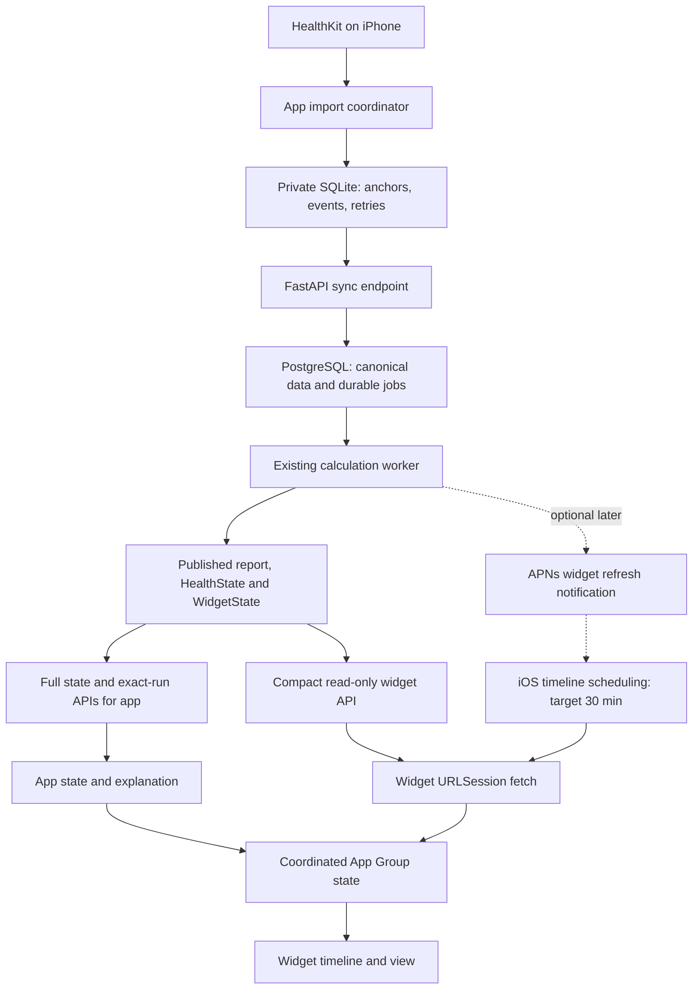

# G1 completion: system design and implementation plan

Prepared: 2026-09-30. Status: **Approved; software implementation recorded in [Implementation_2026_09_30.md](Implementation_2026_09_30.md). Device acceptance remains open.**

Implementation order and duplicate-data release gates are consolidated in the
[Master implementation plan](Master_implementation_plan.md).

This covers the remaining G1 acceptance work and the requested independent
widget refresh. It extends the cache-only design in Step_14_16_plan.md. Existing
health calculations, canonical data, replay and upload durability stay central.

Future scope is specified in [Multiple sources and platforms](Multi_source_platform_architecture.md).
That plan carries forward every G1 gap here and defines the later connector,
identity, selection and platform changes. Its future account-wide controls do
not require implementing new providers before finishing G1.

## 1. Outcome and constraints

The widget should retrieve a completed server calculation without the user
opening Homeostat. Request a new timeline approximately every 30 minutes, retain
the last valid result offline, and display the age of the underlying data.

There are two separate delivery paths:

1. **Phone → server:** HealthKit wakes the app when allowed; the app imports,
   persists and uploads measurements. Opening the app also catches up.
2. **Server → widget:** WidgetKit runs the extension; it fetches a small result
   independently of the main app. An optional later APNs notification requests
   an earlier widget refresh after a calculation publishes.

Thirty minutes is a scheduling target, not a guaranteed interval. HealthKit
reads can fail while the phone is locked. A successful widget fetch cannot
obtain measurements the phone has not uploaded. Ordinary suspension, OS
termination, user force-quit and reboot are separate test cases; do not promise
identical background behavior for them. Sources: [Apple timeline scheduling](https://developer.apple.com/documentation/widgetkit/keeping-a-widget-up-to-date/),
[HealthKit locked-store errors](https://developer.apple.com/documentation/healthkit/hkerror/errordatabaseinaccessible),
[HealthKit background delivery](https://developer.apple.com/documentation/healthkit/hkhealthstore/enablebackgrounddelivery%28for%3Afrequency%3Awithcompletion%3A%29).

**Planning assumption:** include an always-available HTTPS backend for Wi-Fi and
cellular. This is the recommended deployment branch; the user has been asked
whether local-Mac testing alone is sufficient. A local-only choice changes
deployment and acceptance expectations, not the client architecture. No cloud
provider, spend or deployment is authorized by this planning document.

## 2. Architecture



### Ownership

| Component | Owns |
|---|---|
| App / HomeostatCore | HealthKit import, normalization, anchors, upload queue, full state and provenance |
| FastAPI + PostgreSQL | Authentication, canonical records, durable recalculation, published results |
| Existing worker | Deterministic calculations and existing day-finalization work |
| HomeostatShared | Widget contracts, scoped configuration, ordered cache access, small HTTP reader and display policy |
| Widget extension | One bounded fetch per due refresh, cached fallback and rendering |
| iOS | Execution opportunities, widget reload timing and background budgets |

Retain SwiftUI, WidgetKit, HealthKit, URLSession, Security/Keychain, GRDB for the
app, FastAPI, PostgreSQL and Alembic. The extension remains independent of
HealthKit, GRDB, the upload queue and the calculation engine. Existing App Group
entitlements can support explicitly shared Keychain items. No new third-party
client library or queue service is needed. [Apple Keychain sharing](https://developer.apple.com/documentation/security/sharing-access-to-keychain-items-among-a-collection-of-apps)

## 3. Research and design choices

| Option | Decision | Reason |
|---|---|---|
| Widget network fetch during timeline generation | Required | Supported by Apple; removes dependence on the app fetching completed results |
| Timeline reload after 30 minutes | Required, best effort | Fits the requested behavior; retain stale/midnight timeline entries separately |
| HealthKit observers + BGAppRefresh | Required | Supplies new phone data and catches up after missed opportunities |
| Backend recalculation every 30 minutes regardless of inputs | Avoid | Re-reading an existing result is cheap; recalculating unchanged inputs does not provide new observations |
| WidgetKit APNs updates | Optional later phase | Useful after publication, but needs credentials, token lifecycle and delivery bookkeeping |
| Silent push to wake the app as the main clock | Avoid | Delivery is not guaranteed and cannot guarantee fresh HealthKit access |
| Background URLSession for the widget's small GET | Defer | Start with a bounded inline request; add transfer/session lifecycle complexity only if measurements justify it |
| Redis, Celery, WebSockets, microservices | Not needed for G1 | PostgreSQL already holds durable jobs and the worker already retries them |

Apple permits inline and background network requests from an active widget
extension. Use the inline path for one small JSON response. [Widget networking](https://developer.apple.com/documentation/widgetkit/making-network-requests-in-a-widget-extension?changes=__8)

WidgetKit budgets reloads dynamically; commonly cited 40–70 refreshes/day for
frequently viewed widgets is guidance, not an entitlement. Background task
dates are earliest start times. [Widget scheduling](https://developer.apple.com/documentation/widgetkit/keeping-a-widget-up-to-date/),
[BGTask scheduling](https://developer.apple.com/documentation/backgroundtasks/bgtaskrequest/earliestbegindate?changes=_3)

APNs widget notifications request a timeline reload, and Apple delivers them
opportunistically. They supplement periodic fetching. [Widget push updates](https://developer.apple.com/documentation/widgetkit/updating-widgets-with-widgetkit-push-notifications?changes=_3)

## 4. Shared configuration, authentication and cache

### 4.1 Read-only credentials

Do not move the app's ingestion key into the widget. Add an opaque, randomly
generated widget token with permission only to read the compact current state.

- The authenticated app provisions a token for its installation. The server
  stores a digest, user/installation binding, creation time and revocation time.
- Keep this token in Keychain with an explicit shared access group. The existing
  App Group can be used as that group; validate both signed targets on-device.
- Use `AfterFirstUnlockThisDeviceOnly`, matching the app's existing background
  credential availability. Before first unlock, render unavailable/cached state
  without treating an inaccessible Keychain as a deleted account.
- Keep the main ingestion key private to the app. No secret goes into shared
  JSON, URLs, diagnostic logs or widget links.
- Token creation is retry-safe using a provisioning operation ID and a
  client-generated high-entropy secret; the server accepts the same operation
  again without rotating it unexpectedly. Commit the Keychain item before
  activating its shared configuration.
- Token invalidation, rotation and endpoint changes are handled by the app;
  widget 401 responses stop automatic authentication retries until settings
  change. No login/token refresh flow inside the extension.

The token table is one additive Alembic migration after 0004. This is still the
single-user G1 backend; this work does not imply a production multi-user login
system. [Apple Keychain availability](https://developer.apple.com/documentation/security/ksecattraccessibleafterfirstunlockthisdeviceonly)

### 4.2 Stable scope and configuration generation

The current store name hashes URL + API key. Key rotation currently changes
local identity. Introduce a stable authenticated user identifier plus configured
server identity for the account scope; use a separate random **configuration
generation** for each settings activation. Keep `installation_id` stable for
that local store. During upgrade, map the existing scoped database to the new
identity without discarding its anchors, queue or installation ID.

Store these nonsecret fields in the shared configuration:

`schema, scope, generation, base_url, credential_id, sync_enabled`.

Settings apply in stages: validate URL/auth and save credentials, cancel old
work, then atomically activate the new configuration and clear incompatible
cache. Failed setup preserves a clearly identified prior configuration or
disables it explicitly; it must not mix new settings with old state. Failed
Keychain writes are surfaced, not reported as saved.

For G1, rename the existing send toggle to **Sync with server** and explain that
it controls uploads and automatic widget fetching. Off means no new app/widget
network requests; the last valid cache remains visibly dated. An already sent
request cannot be recalled. A scope change clears the old account's visible
state. A separate fetch-only preference can be added later if requested.

### 4.3 One coordinated shared state

Both app and widget will write the widget result. An atomic file rename alone
does not protect the read/compare/write sequence from concurrent writers.

Use `NSFileCoordinator` around a single shared manifest containing active
configuration, cached WidgetState, fetch status and a short fetch lease. All
read/modify/write operations coordinate the same URL. Inside the coordinated
operation, re-read the manifest, validate scope/generation, compare ordering,
and atomically replace the file. Never await a network request or hold a lock
while calling Keychain or UIKit. Keep payloads small and do not use file
presenters. [Apple extension shared-data guidance](https://developer.apple.com/library/archive/documentation/General/Conceptual/ExtensibilityPG/ExtensionScenarios.html)

Rules:

1. Accept data only for the currently active scope/generation.
2. Preserve `(input_revision, run_id)` ordering for the same server/account.
3. Reject a late response after settings change, sync disable or token change.
4. Persist a short expiring fetch lease so multiple widget instances do not
   issue duplicate requests; a killed process cannot leave a permanent lock.
5. Preserve the last valid cache on timeout, bad JSON or unsupported version.
6. Schema-1 cache migration is app-owned; an extension started before migration
   can render the existing file without networking. New schema remains
   forward-detectable. No store deletion is needed.

The shared cache contains presentation and identity only. Full health reports
remain in the app database/server. Operational `last_checked_at` is distinct
from `widget_state.freshness.last_updated_at` (the data's effective time).

## 5. Backend read contract

Add `GET /v1/widget/current`, authenticated by the widget token. It reads already
published data; a GET never imports, recalculates or advances freshness.

Example envelope (illustrative values):

```json
{
  "schema": 1,
  "account_id": "authenticated-user-uuid",
  "calculation_status": "pending",
  "accepted_revision": 43,
  "published": {
    "day": "2026-09-30",
    "timezone": "America/Chicago",
    "input_revision": 42,
    "run_id": 117,
    "widget_state": { "...": "existing WidgetState contract" }
  }
}
```

- `published` is null when no result exists. Return a valid 200 envelope for
  this state; distinguish it from endpoint-not-found, authentication and outage.
- `calculation_status` is `ready | pending | failed | no_state`. Inspect durable
  jobs as well as accepted/published revisions; a same-revision day-finalization
  job can be pending too. Failed means the current job recorded a failed attempt
  and is awaiting retry, not that its previous published result is invalid.
- Read state/revision/job status from one consistent database snapshot.
- Return only WidgetState and small metadata, not HealthState/provenance.
- Auth failures return 401; throttling/temporary unavailability can use
  Retry-After. Bound response size in the client and reject malformed identities.
- Use `Cache-Control: no-store` and an ephemeral client session. Explicitly
  persist only the validated App Group result. Do not redirect credentials to a
  different origin; require HTTPS outside a narrowly scoped development setup.
- Initially return small 200 responses; defer ETags until useful. This avoids
  incorrect 304 handling for changed pending status, day or timezone.

Provision/revoke routes use the app credential and bind tokens to that user and
installation. Token reads cannot call sync, debug, token-management or full
health-report endpoints. Test the authorization boundaries explicitly.

Add authenticated `GET /v1/state/runs/{run_id}` for the app to retrieve the exact
displayed run. Enforce user ownership and return an honest not-found state if
the report is unavailable. This route is registered so it cannot be interpreted
as the existing day route. Full current/day state APIs remain compatible.

## 6. Refresh behavior

### Widget path

1. Read active configuration and best cached result.
2. If disabled, unconfigured, credentials inaccessible, a recent successful
   check exists, or another fetch lease is active: render cache and schedule.
3. Otherwise acquire an expiring lease and make one GET. Initial engineering
   limits: 10-second total request deadline, 256 KiB response cap. These are our
   bounds, not a claim about Apple's available execution budget.
4. Revalidate scope/generation and lease before storing the response.
5. Return a timeline exactly once on all paths. Network errors retain cache.
6. Ask for the next refresh after 30 minutes (small positive jitter is allowed).
   Time-based stale and midnight entries still use their real boundaries.

App-triggered reloads shortly after a successful cache update render the cache
without redundant networking. Multiple instances share due time and lease.
An expired lease is recoverable even after process death. Gallery/placeholder
requests do not create a network loop.

Pending calculation keeps the previous dated result and records pending status.
Do not start a tight widget polling loop. Normal 30-minute checks will discover
publication; optional APNs can shorten the delay later. On transport/5xx failure,
back off 30 → 60 → 120 minutes, respecting a longer Retry-After; a successful
check resets backoff. A foreground app sync can recover immediately.

### App background path

- Use one cancellable coordinator for observer-triggered work and scheduled
  catch-up. Capture scope/generation at entry; late work cannot affect a new
  account's UI or cache.
- Begin the background execution allowance before completing the observer
  callback if work is to continue afterward. Completion is called exactly once
  after relevant changes or a deferred-import checkpoint are durable, independent
  of server availability. Do not retain HealthKit completion until networking ends.
- Bound total work by an explicit deadline, not only three requests each of
  which can currently take 60 seconds. Start with a conservative 20-second
  cooperative work deadline and always honor earlier OS expiration.
- Coalesce bursts into one active pass and at most one immediate extra pass;
  persist remaining work instead of an unbounded rerun loop.
- Schedule one BGAppRefresh request around 30 minutes while sync is enabled,
  or an earlier persisted retry deadline when suitable. Include coverage-only
  backlog and pending calculation, not just event/scan counts. Do not repeatedly
  push an existing earlier request later. Reschedule on failure/expiration too.
- Return structured outcomes: import deferred, upload deferred, calculation
  pending, refreshed, failed, cancelled. Fetch/network failure must not be
  reported as successful refresh merely because the task returned.

### Import coherence

Current background callbacks refresh only the changed domain. The backend uses
the minimum coverage end across participating domains. Therefore a morning
sleep/HRV coverage boundary can hold back afternoon movement calculations.

Use a coalesced **current-data cycle** for background changes: drain incremental
queries for each sample type and refresh yesterday/today steps. Set a common
`through` time at cycle start; successful queries declare coverage through that
time and step snapshots include that same boundary. This avoids a sequential
query timing mismatch in which the current step snapshot is later than the
earliest other-domain cutoff. Anchors remain based on the existing stable query
predicate; do not invalidate anchors by adding a moving upper predicate bound.
Samples retrieved beyond `through` may be saved but are selected according to
the recorded calculation context.

If a domain fails/locks, leave it incomplete and the result conservatively dated.
Do not replace the backend minimum with a maximum or fabricate coverage.
Persist a deferred-import flag and retry on the next permitted wake, protected
data availability while alive, or foreground catch-up. Do not assume an unlock
notification can launch a terminated app.

Make step statistics refresh single-flight too; current actor reentrancy allows
overlapping step refreshes. Keep the existing full historical repair in a
separate resumable job, not on every widget request or observer burst. Daily
full repair currently grows from a fixed import lower bound: use bounded chunks
and checkpoints first, preserving coverage semantics and historical correction
support. Any rolling-window truncation is a separate contract decision.

## 7. App/widget agreement and user-visible status

- A widget can become newer than the app's full-state cache. Its deep link must
  include `scope` and `run_id`. Fetch the matching full report before displaying
  "Why this state"; do not substitute another run's explanation. An offline
  mismatch displays the widget summary plus "Explanation available when online."
- The main app checks shared revision/run on launch and updates its own full
  state. An older app response cannot overwrite the newer shared result.
- Cache display handles any day different from the phone's current day, including
  a future local day after travel. Use the explicit date until current-zone sync
  catches up; do not present that state as today's or silently reinterpret it.
- Display data age and connection state independently. "Checked recently" never
  means "new health data." Keep the existing 90-minute data-staleness rule for
  this phase; verify the wording against real sampling patterns.
- Persist compact diagnostics: observer registration result, last import
  success/failure per domain, accepted/published revisions, pending calculation,
  last fetch attempt/success, cache write and timeline generation times, retry
  due time, background expiration and protected-data status. A generated timeline
  is not proof that iOS displayed it at that instant.
- Successful imports clear earlier transient error messages. Show actionable
  categories (locked, offline, authentication, calculation pending, incomplete
  recovery) without exposing secrets or sample values in logs.

## 8. Additional gap audit

This is a static architecture/code review, not a new device trace or exhaustive
security audit. "Confirmed" means the path is present in the inspected code;
it does not identify the precise cause of the user's observed stale widget.

| Gap / evidence | Assessment | Planned closure |
|---|---|---|
| Widget `Provider.getTimeline` only reads cache; WidgetPolicy reloads after midnight | Confirmed missing independent fetch | §5–6 |
| BackgroundSyncRunner performs one state GET; scheduler ignores calculation publication lag | Confirmed path that can miss later publication | Durable status + independent fetch + scheduled catch-up |
| `handleObserverUpdate` refreshes one domain; `recalc.import_cutoff` takes minimum domain coverage | Confirmed freshness bottleneck; sequential timestamp mismatch also needs a regression | Common-through current-data cycle |
| `enableBackgroundDelivery` discards success/error; observersRegistered is set before results | Confirmed diagnostic/retry gap | Persist per-type registration and retry failures on next eligible setup |
| BackgroundSyncRunner discards upload/GET outcomes, returns true, and can rerun repeatedly | Confirmed success-reporting and workload-bound gaps | Structured outcomes, deadline and bounded coalescing |
| Foreground tasks are cancelled on inactive transition; observer task ownership is separate | Lifecycle risk requiring device evidence | Separate foreground cancellation from owned background work; test permission prompts, home/lock and expiration |
| `saveSettings` ignores Keychain write failure; `openStore` can fail before clearing stale scope/cache | Confirmed settings consistency gap | Staged configuration activation and explicit errors |
| Scope hashes credential; rotating key changes local store and installation ownership | Confirmed identity coupling | Stable account scope with migration of existing store |
| Widget credentials/config are not shared | Required new capability, not a defect in cache-only design | Read-only token + explicit shared Keychain access |
| Atomic cache writes have no cross-process compare/write coordination | New race introduced if widget becomes a writer | Coordinated manifest + generation checks + interprocess test |
| Widget link selects only `explain`; app uses its own cached report | Existing possible stale explanation; more likely after independent fetch | Exact run link and authenticated report lookup |
| `refreshSteps` lacks the per-type single-flight mechanism; daily full window grows since installation | Confirmed overlapping-work/cost risk | Coalesce steps and make full repair bounded/resumable |
| `importErrors` is not cleared by a later successful observer import | Confirmed stale diagnostic | Clear per-domain error only after a successful query |
| Current-state API exposes full HealthState and no accepted/job status envelope | Missing contract for efficient independent widget reads | Compact endpoint and consistent status snapshot |
| Local-Mac URL/process availability, signed entitlements and migrations | Runtime prerequisites; not verified in this review | Deployment preflight and on-device checks |
| WidgetPolicy handles prior day but not future local day after timezone changes | Confirmed display-policy gap | Explicit-date display for all noncurrent days |
| No persistent end-to-end timing evidence | Confirmed observability limitation | §7 diagnostics and §11 acceptance record |

Previously documented limits also remain: a scan exceeding payload limits must
stay incomplete, reinstall creates a new installation, and server-only legacy
records cannot be arbitrarily attributed. G1 should expose these conditions and
test bounded supported cases. Installation retirement and chunked scan protocol
are follow-up work unless real-device acceptance encounters these limits.

## 9. Deployment and operation

Recommended G1 topology: one always-on FastAPI/Uvicorn process with the existing
worker thread, managed PostgreSQL, and managed HTTPS termination. Start with one
process so its embedded worker lifecycle is simple. Existing PostgreSQL locking
and durable jobs remain the recovery mechanism. A separate worker service is
unnecessary at current scope. [FastAPI deployment concepts](https://fastapi.tiangolo.com/deployment/concepts/)

Before device acceptance:

1. Confirm current schema revision; apply 0004 and new additive migrations in
   order. Back up existing development data before migration; do not reset it.
2. Verify worker enabled, health endpoint reachable, DB connectivity and a
   deliberately deferred job eventually published. Add authenticated worker
   heartbeat/job-age diagnostics; `/healthz` currently checks only the database.
3. Configure a device-reachable HTTPS URL and verify foreground access first.
   Local development needs appropriate ATS/local-network configuration for both
   targets; never blanket-disable transport security in a release build.
4. Verify iPhone signing/App Group membership and actual shared Keychain access.
5. For an always-available deployment: restart policy, database backup/restore,
   secret configuration and bounded logs. Keep G1 single-user access explicit.

A local-only branch requires the Mac, API and DB to remain awake/reachable and
cannot claim cellular/away-from-home acceptance. Provider selection and actual
hosting setup follow the user's deployment preference.

## 10. Optional APNs phase

After periodic fetching passes real-device tests, add WidgetKit push if lower
publication latency is valuable:

- Register `WidgetPushHandler`; provision the Push Notifications capability and
  upload/update tokens through the authenticated app/extension flow.
- Persist subscriptions bound to user, installation, APNs environment and widget
  configuration; remove invalid tokens and revoke old scope subscriptions.
- Write a coalesced notification job in the same DB transaction as publication.
  The existing worker sends APNs after commit and retries failures. Notification
  delivery cannot fail or roll back a health calculation.
- Send only a content-changed signal, without health payloads. The extension
  fetches the compact endpoint. Push-triggered timelines must be able to bypass
  the normal recent-check suppression with a bounded invalidation marker, so a
  push shortly after a previous GET does not simply redraw old data.
- Keep periodic fetching as fallback. APNs has its own budget; sending a push
  every 30 minutes does not create a dependable clock.

APNs implementation requires confirming the push API behavior/availability in
the installed SDK and a signed build. Existing project deployment target is
iOS 27; do not change the minimum OS as part of this work without a separate
compatibility decision. Test registration and delivery outside the debugger.

## 11. Implementation order and acceptance

| Phase | Work | Exit gate |
|---|---|---|
| A. Diagnose and stabilize import | Persist diagnostics, registration failures, coherent coverage cycle, step single-flight, cancellation/deadlines, safe settings | A real background change can be traced from HealthKit to an accepted revision; deterministic tests cover cutoff and cancellation |
| B. Backend contracts | Compact widget API, read-only token provisioning/revocation, exact-run report route, status snapshot | Auth isolation, replay compatibility and pending→published tests pass; additive migrations preserve existing data |
| C. Shared client foundation | Shared credentials, stable scope migration, manifest coordination, fetch lease, cache migration | Signed app/widget can read the intended credential; concurrent stale responses and account changes cannot replace current cache |
| D. Independent widget refresh | Bounded GET, 30-minute policy, backoff, truthful freshness, noncurrent-day display | Widget fetches a server result while app is not running; offline cache remains usable |
| E. App consistency | Exact-run explanations, current-state reconciliation, network toggle behavior, pending-state retries | Tapped explanation matches displayed run; disabling sync stops new requests |
| F. G1 acceptance | Reachable backend, real HealthKit validation, failure/recovery walkthrough, device replay and evidence | All original G1 §60–61 gates plus independent-fetch behavior recorded |
| G. Optional push | APNs registration, transactional notification jobs and device tests | Publication can request earlier fetch; failed/missing push does not prevent periodic updates |

### Focused automated verification

- API: widget token read-only boundaries; wrong-account run lookup denied;
  no-state/pending/failed/ready; status and state read consistently; no raw health
  fields on widget endpoint; credential rotation and retry-safe provisioning.
- Import: step-only trigger after old other-domain coverage; sequential query
  times; a locked/failed domain; bursts of observers; expiration mid-page;
  anchors advance only with durable data; full-history repair resumes.
- Shared store: two real processes racing older/newer writes, scope change during
  GET, sync disable during GET, crash with active lease, multiple widget instances,
  schema migration, equal-revision later run and invalid payload preservation.
- Fetch: timeout/offline/401/429/503, Retry-After, exactly-once completion,
  no redundant GET after app publication, failed fetch does not refresh data age.
- Display/app: midnight, DST, travel both directions, stale transition, explanation
  for exact run, and cached fallback when detailed report cannot be downloaded.
- Re-run existing Swift/backend/replay gates after implementation, plus app and
  widget compilation. Previously recorded 70 Swift/3,667 backend passes are the
  baseline, not evidence that these proposed changes have already been tested.

### Real-iPhone acceptance record

Use a signed build outside Xcode's debugger; observe normal scheduling for
24–48 hours rather than asserting an exact 30-minute cadence. Record OS/build,
network, power mode, Background App Refresh state, app lifecycle state, import
time, accepted/published revision, fetch/cache/timeline times and screenshots.

1. Fresh install/access → available ~35-day history → source-correct sleep,
   HRV SDNN, RHR, statistics-based steps and workouts → baseline/calibration.
2. New HealthKit change → upload → calculation → matching app/widget result.
3. Already uploaded input publishes while app is suspended/terminated → widget
   independently fetches it. This isolates fetch behavior from HealthKit delivery.
4. Lock/unlock, reboot before/after first unlock, OS termination and deliberate
   force-quit: record their distinct behavior and verify honest fallback/recovery.
5. Wi-Fi/cellular transitions if hosted; network loss and server outage; queued
   events survive restart, later upload once, and the widget retains dated data.
6. Delete/replace sample, corrupt anchor, rebootstrap and acknowledged scoped
   scan: correct withdrawal/restoration with no false complete recovery.
7. Calibration/missing data/stale/prior-or-future-day layouts; multiple widgets;
   exact explanation/provenance when tapped; sync disable and account changes.
8. Replay actual device canonical history with recorded config/versions; verify
   identical states. Preserve screenshots, diagnostic summary and replay output.

Simulator fixtures still cover layout and fault injection. Real-device evidence
is required for HealthKit delivery, protected data, credentials and widget
scheduling. G2/avatar begins only after required G1 gates pass.

## 12. Efficiency and plan updates

At the requested cadence there are roughly 48 scheduled checks/day per active
installation before iOS adjustments; multiple widget instances share checks.
A 4 KiB JSON envelope would be about 192 KiB/day of body data at that cadence,
excluding headers/TLS and retries. This is a design estimate, not a benchmark.
The endpoint performs reads of published data; network checks do not trigger
heavy recalculation. Avoid repeating full history imports for widget refreshes.

After approval, update Step_14_16_plan.md's prohibitions on backend access and
its single-writer assumption to this bounded read-only design. Keep G1's
separation between import, calculations, presentation and widget rendering.
Clarify older cache documentation: `received_at` is currently not implemented,
and typed Swift decoding ignores unknown fields rather than preserving them
through re-encoding. Freeze the new envelope with Swift/Python fixtures.

This plan adds delivery and acceptance work; it does not mark G1 complete or
require an avatar, a new health algorithm, commercial multi-user authentication,
large widget families or a new distributed infrastructure stack.

## 13. Forward-compatible boundaries

- Keep user/account identity separate from installation, source connection and
  rotating credentials. The v2 source namespace design is in the companion plan.
- Keep the widget read contract independent of HealthKit and provider names.
- The G1 common-through import cycle is for the current HealthKit path. Adding
  independent providers requires source-scoped coverage and versioned selection;
  do not make all providers wait for the slowest unused connection.
- Before cloud ingestion is enabled, split the single-device sync toggle into
  clearly scoped upload, connection and result-refresh controls.
- Preserve current v1 requests and replay behavior while later v2 ingestion is
  introduced. G1's remaining acceptance work stays first in the roadmap.
