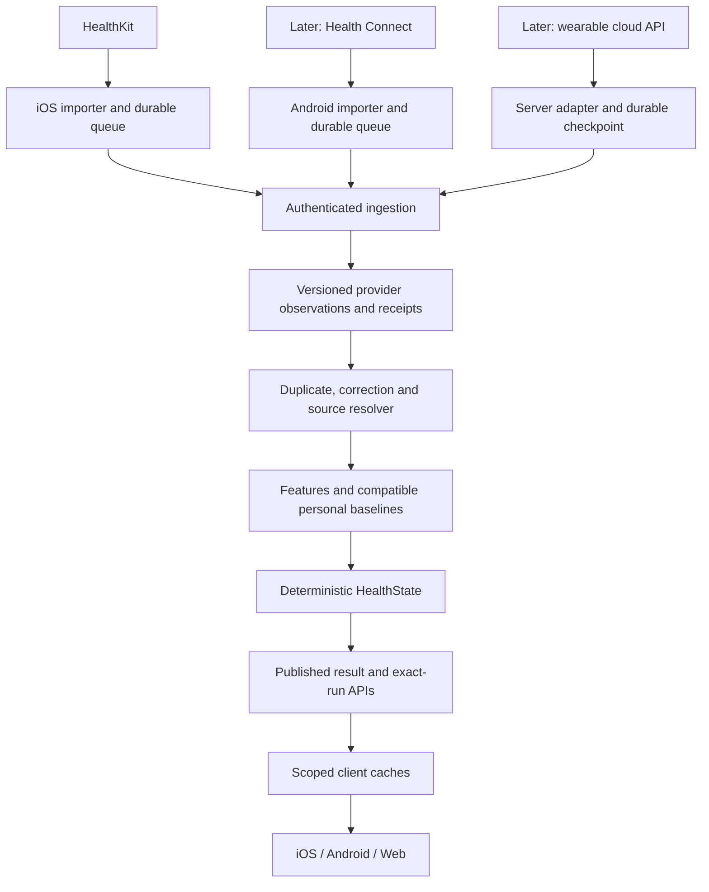
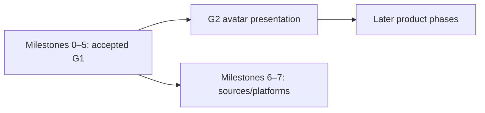

# Homeostat — consolidated implementation plan

Updated: 2026-09-30. Status: **Approved; G1 software implemented, device acceptance open.**

This is the entry point for everything agreed or proposed so far: finish G1,
make widget updates independent, protect against duplicate data, prepare for
multiple sources/platforms, and enter G2 after G1 acceptance. Detailed companion
plans remain useful; where they are ambiguous about duplicate handling, §4 of
this document supplies the conservative policy and release gates.

## 1. Current position

| Area | Status |
|---|---|
| G1 Steps 1–8: contracts, synthetic data, features, state, backend and replay | Implemented |
| G1 Steps 9–13: HealthKit import, local queue, upload and recovery | Implemented; real-device acceptance incomplete |
| G1 Steps 14–16: app cache, widget and background integration | Independent fetching and cache coordination implemented; real-iPhone acceptance remains open |
| Earlier seven review fixes and two reconciliation/workout gaps | Implemented; baseline verification recorded below |
| Independent widget fetching, new lifecycle/settings fixes | Implemented; signed-device verification remains |
| Multiple providers, Android and cross-device accounts | Pure identity/selection foundations tested; full integration remains future scope |
| G2 avatar | Planned; implementation begins after G1 is accepted |

Current verification: **175 targeted backend tests, 84 Swift tests and the
app/widget simulator build passed** on 2026-09-30. Local migrations are at
`0005`. See [implementation record](Implementation_2026_09_30.md) and
[status](Next_steps.md). Real-device acceptance and full v2 integration gates
remain open; pure provider foundation tests do not close those gates.

## 2. Product behavior we are building

- Health data is imported automatically when the platform permits and catches
  up on app open. Saved events survive outages and restarts.
- The widget retrieves completed server results without needing the main app
  to stay running; request a refresh around every 30 minutes.
- Server checks, calculation time and underlying measurement/query freshness
  are distinct. Old data never becomes fresh just because a GET succeeded.
- Sleep, steps, workouts and daily baseline observations do not gain additional
  weight merely because the same information arrives by another route.
- Every displayed result identifies its calculation run and can explain its
  selected source, measurements, exclusions and baseline.
- One account can later connect different devices/providers and show the same
  accepted result on iOS, Android and web.

Thirty minutes is a best-effort scheduling target. iOS controls widget execution;
Android periodic work is also inexact. Phone-only HealthKit data must still be
uploaded by the phone; a widget server fetch cannot bypass locked health-store
access. Cloud integrations can supply updates independently once the provider
cloud has received the data. Platform research is linked in the companion plans:
[G1 delivery constraints](G1_completion_architecture.md#1-outcome-and-constraints),
[platform support](Multi_source_platform_architecture.md#3-source-support-and-platform-responsibilities).

## 3. Architecture and storage

Keep one backend calculation pipeline. Reuse FastAPI, PostgreSQL and the existing
durable calculation worker. iOS remains SwiftUI/HealthKit/WidgetKit with GRDB.
Android later uses Kotlin/Health Connect, Room, WorkManager and Glance. Share
contracts and test fixtures; platform permissions and scheduling stay native.

### Current iPhone database

| Table group | Tables and responsibility |
|---|---|
| Import progress | `authorization_ledger`, `query_anchors` |
| Provider identity | `provider_records`, `provider_timezones`, `deletions` |
| Step history index | `step_buckets` stores cumulative totals at cutoffs |
| Repair | `quarantine` retains samples needing repair |
| Durable delivery | `event_outbox`, `coverage_outbox`, `upload_requests` |
| Recovery membership | `generation_members`, `visibility_outbox` |
| Sync metadata/cache | `sync_state`, including installation ID, server revision and returned full state |

These are 13 application tables; GRDB also tracks migrations. JSON event/request
bodies are stored as bytes. Acknowledged records remain stored but cease to be
pending work. Credentials live in Keychain. Widget display data lives in the
App Group. Calculations and canonical replay history live in PostgreSQL.

New G1 work adds a shared read-only widget credential/configuration and a
coordinated cache. Future provider support adds connection identities,
checkpoints, credential lifecycle, source policies and provider version/link
records. It does not require copying the entire server database to every phone.

## 4. Duplicate-data policy — mandatory acceptance requirement

### 4.1 What we can and cannot establish

Exact delivery/provider duplicates can be detected deterministically. Two
independent vendors may describe the same activity with different IDs, times
and values; universal duplicate detection is not provable from similarity alone.

Our rule for ambiguous cases is **retain the alternatives, select a conservative
authoritative contribution, and explain exclusions**. Never silently combine
overlapping route totals or erase independent measurements as guessed duplicates.
Conservative selection may omit a legitimate secondary-source activity; expose
that limitation instead of claiming perfect reconciliation.

### 4.2 Four layers of protection

| Layer | Identity / rule | Result |
|---|---|---|
| HTTP request retry | User + request ID; exact body digest must match | Retry returns its saved acknowledgement; changed body under same ID is rejected |
| Event delivery retry | User + event ID; immutable event digest | Repeated delivery has one ingestion effect; changed content under the same ID is rejected |
| Provider observation/version | User + provider account/store namespace + record type + provider record ID + authoritative version/content identity | Re-reading or importing from a second known reader adds provenance/visibility, not another measurement contribution |
| Cross-route observation | Verified upstream identity and versioned relationship evidence | A proven mirror is one contribution; otherwise use domain source selection without inventing an identity link |

Networks and webhook systems may deliver more than once. Database constraints,
transactions and saved receipts provide idempotent effects. Do not promise
exactly-once network delivery.

Identity includes the provider account/store namespace, not just a label such
as `healthkit` or `garmin`. It excludes rotating credentials. Matching IDs in
unrelated accounts/providers do not identify the same observation. A common
namespace across two local stores must be established by supported evidence.

Content fingerprints are versioned canonical hashes with stable numeric/time
serialization. They exclude delivery IDs and receipt times; do not use an equal
value/time hash alone to merge distinct provider identities. Keep full payload
digests for auditing and detect contradictory versions explicitly.

### 4.3 Domain rules

| Domain | Conservative first multi-source policy | Example |
|---|---|---|
| Steps | One selected aggregate stream per local day and comparison cutoff. A cumulative total is a snapshot, not an amount to add to earlier snapshots or another platform's total. | 8,000 via HealthKit and 8,200 via Health Connect remain alternatives; selected source determines the result |
| Sleep | One eligible primary source/representation for the overnight episode; union overlapping asleep intervals within that selected stream and apply its awake exclusions. Keep naps separate under the same provenance rules. | Two devices describing the same night yield one selected night |
| Workouts | Resolve proven aliases first. Default to one authoritative workout stream for the reporting window when cross-route identities are uncertain. Secondary-stream additions require established distinctness or an explicit reviewed policy. | A 40-minute workout exported twice contributes one selected session |
| HRV / resting HR | Select one compatible series and its documented daily reading. Baseline counts are valid days, not event deliveries. | Ten retries of the same reading still contribute one day's observation |
| Provider summaries/scores | Keep separate metric and aggregation identities | A sleep score cannot be added to sleep duration or used as a Homeostat score |

Do not splice cumulative step totals from two providers during a day unless
non-overlapping interval provenance makes that operation valid. A source change
reselects a comparable whole-day stream or shows incomplete information.
Do not choose the largest total or add a platform aggregate to its raw inputs.

For workouts, overlap detection alone is insufficient: clock drift, edited
boundaries and summary-versus-segment representations can create false extra
minutes at the edges. The conservative stream policy avoids automatically
filling those edges from a potential mirror. It is a **new v2 policy**, not a
silent rewrite of G1's existing segment-based resolver. More permissive merging
needs its own demonstrated accuracy and replay version.

For sleep summaries without stages, preserve the summary as such. Never create
invented minute-by-minute stages to make it match another provider.

### 4.4 Linking and ambiguity

- Strong evidence: same namespace/provider ID, or a provider-specific upstream
  identifier whose semantics and account binding have been validated.
- Similar timestamps, duration, value or device name are candidate evidence
  only. Similarity must not create automatic transitive identity groups.
- Links and overrides are scoped to a user and versioned with their evidence.
  Resolve the selected representative deterministically at a recorded revision.
- A corrected link can split a mistaken group and trigger a new calculation;
  old run evidence still explains the decision made at that time.
- The first expansion uses configured per-domain source preference and reports
  uncertain alternatives. An interactive merge/split editor is optional future
  work, not required for the conservative resolver to function.

### 4.5 Corrections, deletion and reconnects

- Provider corrections are immutable new versions. Select the authoritative
  version available at the recorded knowledge cutoff, using provider semantics.
  Equal-version contradictions remain conflicts. Arrival order is not authority.
- Deleted record targets include the full namespace/type identity where the
  provider supplies that scope; retain the mapping required by ID-only deletion
  feeds. Unrelated records with the same bare ID survive.
- Deleting a HealthKit mirror affects that route's record. It does not itself
  prove the direct provider record was deleted. Cross-route identity links do
  not transfer permission to erase another source.
- A disconnected/expired cursor is not evidence of deletion. Finalize visibility
  scans only after all pages and required event acknowledgements succeed.
- Reconnecting a verified provider account retains its stable namespace. A new
  app installation is not automatically a new physical measurement source.
- Uninstalling the app can remove unsent local data. Reinstall recovery re-reads
  what the provider still exposes and deduplicates against retained server
  history; it cannot promise recovery of every lost local-only event.
- Account/source erasure revokes work and prevents old jobs restoring data;
  retained replay data must follow the user's deletion decision.

### 4.6 Tests that block a second-source release

| ID | Scenario | Required assertion |
|---|---|---|
| D01 | Same batch/event delivered repeatedly, including concurrently | One ingestion effect and unchanged selected values |
| D02 | Same provider record read by two proven readers | One measurement contribution; both reader memberships retained |
| D03 | Equal bare IDs in different namespaces/users | No collision, shared deletion or cross-user access |
| D04 | Direct API plus HealthKit/Health Connect mirror | Proven duplicates count once; uncertain routes follow the conservative source policy |
| D05 | Similar-but-distinct readings/workouts | No destructive auto-merge; excluded alternatives are explainable |
| D06 | Two step aggregates, cumulative snapshots, late downward correction | No summation inflation; latest authoritative correction applies |
| D07 | Overlapping sleep intervals, two nights, naps and summary-only source | Correct interval union; one primary night; no fabricated stages |
| D08 | Mirrored workout with shifted start/end and pause differences | No extra edge minutes automatically imported from another stream |
| D09 | New/old provider corrections arrive in both orders | Same result at equivalent known inputs; old historical replay unchanged |
| D10 | Delete one mirror, unrelated same-ID record, or completed scan | Deletion/withdrawal affects only its supported scope |
| D11 | Retry after app/server crash, reinstall, credential rotation or reconnect | Crashes/rotation preserve durable requests; reimport does not inflate counts; unavailable local-only data is reported |
| D12 | Different HRV methods and provider/algorithm switch | Separate comparable series and appropriate recalibration |
| D13 | Incomplete scan, denied/revoked access, missing history and expired cursor | No false complete coverage or fabricated zero/deletion |
| D14 | Multiple widgets/clients fetch the same published run | Read requests create no new health events or calculations |
| D15 | A mistaken alias link is corrected | New result corrects selection; old run remains reproducible |

Also check invariants: adding another delivery of an identical observation cannot
change totals or usable-day counts; reordering delivery produces the same result
for the same visible provider versions; selection is deterministic; selected
aggregate contributions never include an aggregate together with its known
components. Repeat the relevant scenarios with real adapter data before release.

## 5. Ordered implementation work

### Milestone 0 — baseline and device diagnosis

- Confirm installed app build, backend URL/reachability, migration 0004 and worker
  status. Capture one real HealthKit change through upload, publication and cache.
- Persist observer-registration results, per-domain import success/errors,
  upload/published revisions, fetch/cache/timeline times and expiration reasons.
- Show the difference between import failure, offline upload, pending
  calculation, stale data and delayed widget scheduling.

**Exit:** the stopping point is observable; do not infer the user's failure from
static review alone. Owner: AppModel/AppDelegate, debug screen, backend diagnostics.

### Milestone 1 — reliable and coherent iPhone import

- Coalesce all current-data reads into a common-through cycle; prevent a stale
  other-domain query time from hiding new movement data.
- Make step refresh single-flight and historical repairs resumable/bounded.
- Persist import deferral for protected-data failures and retry on a permitted
  wake or foreground catch-up. Clear old errors after actual success.
- Own cancellation for foreground/background work separately; bound total work,
  cap reruns, and handle observer completion and OS expiration exactly once.
- Use structured outcomes; a failed GET/upload is not reported as refresh success.

**Exit:** regression tests plus a traceable real-device background import. Owner:
ImportEngine, HealthKitSource, BackgroundSyncRunner and AppModel.

### Milestone 2 — identity, settings and backend read contracts

- Separate stable account scope from API-key rotation; migrate existing local
  identity without resetting queues, anchors or installation ownership.
- Make settings activation transactional and surface credential-write failures.
- Add compact widget current-state/status API, narrow read-only widget token
  provisioning/revocation, and authenticated exact-run explanation lookup.
- Preserve old APIs and replay; apply additive migrations before new clients.

**Exit:** ownership, credential rotation, pending→published and migration tests
pass. Owner: backend API/schema, Keychain/configuration and local-store migration.

### Milestone 3 — safe shared state and independent widget refresh

- Share the widget credential explicitly through Keychain; keep the upload key
  private. Coordinate configuration/cache compare-and-write across processes.
- Reject old account/configuration generations and older revision/run results.
- Fetch one small result when due, with a deadline, payload limit, recoverable
  lease and backoff; retain cache on failure.
- Request a roughly 30-minute timeline refresh. Keep stale/midnight transitions
  and handle noncurrent local dates, including future dates after travel.
- Recent app publication and multiple widget instances should share work.

**Exit:** widget independently fetches a newly published result while the app
is not running; cache race/expiry/offline tests pass. Owner: HomeostatShared,
WidgetKit provider and shared entitlement/configuration wiring.

### Milestone 4 — app agreement and pending work

- Include scope/run identity in widget links and open the matching explanation.
- If that full report is unavailable offline, display the matching summary and
  an honest unavailable explanation state.
- Reconcile app full-state cache with newer shared widget results.
- Schedule catch-up for pending calculation, coverage-only backlog and retries.
  Avoid repeatedly moving an earlier background request later.
- Make the G1 sync toggle stop new app/widget network requests consistently.

**Exit:** app/widget values and explanation refer to the same run; older
responses and account changes cannot restore stale or another account's data.

### Milestone 5 — deployment and G1 acceptance

- Recommended branch: always-available HTTPS API plus PostgreSQL, existing worker,
  backups and restart policy. Local-only testing remains a narrower option.
- Verify signing, shared credential access, database migrations and worker
  publication. No hosting provider or spend is selected by this document.
- Complete original G1 §60–61, independent-fetch tests, outage/restart drills,
  lost-anchor/deletion recovery and replay of actual device data.
- Observe normal widget behavior outside the debugger over 24–48 hours; record
  device/build/network/power conditions instead of asserting exact scheduling.

**Exit:** recorded G1 acceptance evidence. Automated tests alone do not close it.

### Milestone 6 — foundation for a second source

- Versioned v2 provider-neutral schema, explicit metric capabilities and full
  namespaced identities throughout storage, deletion, diagnostics and provenance.
- Provider correction resolver, verified record links and §4 selection policy.
- Connection-scoped coverage/watermarks; unused providers cannot stall results.
- Compatible baseline-series identity; preserve SDNN/RMSSD and summary/interval
  distinctions. Account reporting timezone has an explicit authority.
- Account authentication/device registration before cross-device public access;
  connection credentials, checkpoints, pause/revoke/erase semantics.
- Preserve v1 assigned request bytes, old hashes/reports and old replay dispatch.
  Validate v2 against synthetic overlapping-source fixtures before activation.

**Exit:** D01–D15 and migration/replay gates pass before real second-source input
is allowed to influence published state.

### Milestone 7 — one new source, then its surfaces

- Default proposed priority: Android Health Connect, unless the user chooses a
  direct wearable first. Use per-type checkpoints, capability-aware history and
  background permissions; test real corrections/deletions and duplicate routes.
- A direct cloud adapter requires approved provider access, OAuth lifecycle,
  serialized refresh, durable jobs and bounded backfill. Provider notifications
  supplement reconciliation/polling and are deduplicated before processing.
- Add Android app/widget or web read surfaces using the shared result/run API.
- Validate same account/run semantics across devices and trace source exclusions.

**Exit:** adapter-specific real-data acceptance and D01–D15 for its supported
metrics. Add further providers incrementally, with the same entry gate.

### Optional — faster publication notifications

After the fetch path is reliable, add APNs widget pushes and an appropriate
Android delivery mechanism when needed. Create notifications after durable
publication with retry/deduplication. A push prompts a bounded fetch, includes no
health payload and cannot be the sole correctness mechanism. This is not a
fixed 30-minute clock.

## 6. Earlier gaps: where each is closed

| Gap | Milestone |
|---|---|
| No automatic widget server fetch / midnight fallback | 3 |
| Published result missed after background task exits | 2–4 |
| Stale domain cutoff and mismatched query times | 1; generalized by 6 |
| Hidden observer registration failures / stale import error messages | 0–1 |
| False success, long requests, repeated reruns and lifecycle cancellation | 1 |
| Failed settings/Keychain writes and old scope/cache | 2–3 |
| Key rotation changes local store/installation | 2 |
| Missing shared widget credentials | 2–3 |
| Concurrent cache writers / old responses | 3 |
| Wrong explanation for the displayed widget | 4 |
| Overlapping steps / growing historical repairs | 1 |
| Missing compact read and calculation status | 2 |
| Local-only service, migration/worker/signing uncertainty | 0, 5 |
| Timezone and future-day display | 3; account-wide authority in 6 |
| Missing end-to-end device evidence | 0, 5 |
| HealthKit-only event and visibility schemas | 6 |
| Bare-ID deletion and record collisions | 6, D03/D10 |
| Corrections classified as conflicts | 6, D09 |
| Global coverage and provider-less step buckets | 6, D06/D13 |
| Apple-specific source ranking and incompatible baselines | 6, D04/D12 |
| Different history permissions / data granularity | 6–7, D07/D13 |
| Development-user authentication and cloud credential lifecycle | 6–7 |
| Connector/resolver versions absent from replay context | 6, D09/D15 |
| Disconnect versus erase and late resurrection | 6–7, D10/D11 |

Known limits remain explicit: oversized scans stay incomplete; unproven legacy
ownership is not assigned arbitrarily; reinstall/retired installation handling
must not erase another reader's valid observations. If actual G1 data reaches a
limit, resolve that blocker before acceptance; otherwise chunked scan and
installation-management extensions remain documented follow-ups.

## 7. Verification and release sequence

1. Targeted tests for each changed behavior, then existing backend/Swift/replay
   suites and app/widget builds. Add interprocess tests for cache coordination.
2. Additive backend migration and compatible endpoints before enabling new
   client features. Verify frozen old requests still retry unchanged.
3. Enable new fetch behavior on the test account/device; validate signed
   credentials, publication lag, cache races and offline fallback.
4. Record real-device G1 acceptance and its replay output.
5. Enable v2 ingestion/resolver only after duplicate and compatibility gates;
   initially compare new output without replacing published results.
6. Introduce a provider/metric subset, validate real observations, then expand.

Record evidence by gate, command/test name, app/backend build, date and result.
Do not mark a gate complete based only on an implemented function or a scheduled
task request. Account/data erasure is intentionally outside immutable-retention
guarantees; derived data and backups need a documented deletion lifecycle.

## 8. G2 and longer-term product scope

After G1 acceptance, G2 introduces `AvatarState`, a pure HealthState-to-avatar
mapper, identity/customization, static widget rendering, app animation and
accessible explanations. Source adapters do not choose avatar traits. Provider
expansion and G2 may proceed as separate tracks; neither requires every future
provider to be finished. Cross-platform avatar identity synchronization is a
later explicit decision; G2 currently proposes local identity storage.

The existing broader roadmap remains: G3 interaction/check-ins, G4 workout
logging/Live Activities, G5 grounded assistance, G6 replay/what-if interfaces,
G7 experiments, G8 nutrition and G9 further platform/product expansion. These
are later scope, not additional acceptance requirements for the current G1.
Android/provider foundations may be brought forward through milestones 6–7
without renumbering the product phases.

The old G2 document incorrectly said G1 Steps 6–16 were still unimplemented and
permitted avatar implementation immediately; its entry conditions are updated
alongside this consolidation to reflect the actual G1 acceptance gate.

## 9. Decisions and document map

Recommended defaults: conservative duplicate/source selection, one backend,
native platform integration, hosted HTTPS for away-from-home use, periodic
widget fetch first, optional push later, G1 acceptance before avatar work.

Unresolved preferences do not block planning: hosted versus local-only G1,
first expansion (Android/direct wearable/web), and specific vendor enrollment.
No hosting subscription, new provider connection or app implementation is
authorized merely by listing it here.

| Document | Purpose |
|---|---|
| This master plan | Implementation order, status, duplicate policy and release gates |
| [G1 completion architecture](G1_completion_architecture.md) | Concrete iPhone/widget/backend contracts and acceptance |
| [Multiple sources/platforms](Multi_source_platform_architecture.md) | Adapters, v2 schema, source semantics and migration |
| [Next steps](Next_steps.md) | Current status and historical verification |
| [G1 original specification](G1_plan.md) | Original health-engine and end-to-end acceptance requirements |
| [G2 plan](G2_plan.md) | Avatar work after G1 acceptance |

**Next executable work is milestone 0, followed by milestone 1.** The independent
widget read path follows the identity/contracts work. A second real source is
enabled only after its duplicate and compatibility gates pass.
