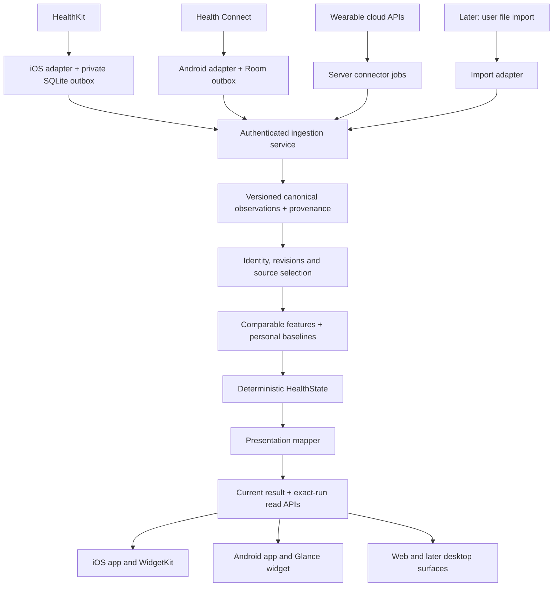

# Homeostat: multiple sources and platforms

Prepared: 2026-09-30. Status: **Proposed architecture; not implemented.**

The [Master implementation plan](../Plan.md) consolidates
the sequence and mandatory duplicate-data gates. Its §4 refines ambiguous
workout/source overlap handling into the conservative initial v2 policy.

Companion to [G1 completion architecture](../archive/G1_completion_architecture.md). This
plan extends the product to other sources and platforms without making their
implementation a prerequisite for finishing the current iPhone G1. All earlier
G1 fixes and acceptance gates remain required; see §11 for the combined roadmap.

## 1. Product model

**One Homeostat account, multiple connections, one explainable calculated result,
and multiple surfaces.**

Keep these identities separate:

| Identity | Meaning | Example |
|---|---|---|
| Homeostat user | Owner of all connected data | The same person on iPhone, Android and web |
| Installation | A particular installed client | iPhone installation A |
| Connection | An authorized ingestion route | HealthKit reader A or Oura OAuth connection B |
| Provider account/namespace | Scope in which provider record IDs are unique | One Oura account; one explicitly defined local-store namespace |
| Origin | What originally produced the measurement, when known | Apple Watch, Garmin device, manual entry |
| Delivery route | How Homeostat received it | HealthKit, Health Connect, direct provider API, file import |
| Record/version | One provider observation and its correction | Provider workout ID + version |
| Output surface | Where the result is displayed | iOS widget, Android widget, web dashboard |

A Garmin observation arriving through HealthKit is not automatically a new
Garmin observation when received from the direct API. Conversely, equal-looking
measurements from two devices are not automatically duplicates.

The server owns accepted canonical history, selection decisions and calculated
results. Phone databases own durable import/upload progress and cached results;
they are not synchronized to each other as database files.

## 2. System architecture



Use a **modular backend in the existing FastAPI service**. Modules may be
`connections`, `adapters`, `ingestion`, `resolution`, `calculations`, `delivery`.
Use PostgreSQL for durable connector work and existing recalculation jobs.
Keep remote network calls outside database transactions and per-user locks.
There is no initial need for Kafka, Redis, a service per vendor or a second
calculation implementation.

Cloud adapters call the same ingestion application service as mobile uploads;
they do not bypass validation and write directly into published outputs.
Ingestion, acknowledgement and calculation are separate durable stages.

## 3. Source support and platform responsibilities

| Source/platform | Ingestion location | State delivery | Important constraint |
|---|---|---|---|
| iPhone / HealthKit | Existing native Swift adapter | App + independently fetching WidgetKit extension | Phone data access and background execution remain OS-controlled |
| Android / Health Connect | Native Kotlin adapter | App + WorkManager-driven Glance updates | Check feature availability, history/background permissions and Changes token expiry |
| Direct wearable API | Server adapter after provider authorization | All signed-in surfaces use the same backend result | Requires vendor access, consent, rate-limit and token handling |
| Web / desktop initially | No local health-store ingestion | Authenticated result/history/explanation views | Does not automatically have access to a phone's health store |
| CSV/file/manual later | Explicit import adapter with preview | Same backend pipeline | Preserve import identity and user corrections; never fabricate sensor provenance |

### Recommended client stack

- Keep iOS in SwiftUI/HealthKit/WidgetKit with GRDB.
- Add Android using Kotlin, Health Connect, Room/SQLite, WorkManager and Glance.
  Room is Google's recommended SQLite abstraction. [Room documentation](https://developer.android.com/training/data-storage/room?authuser=429)
- Share OpenAPI/JSON schemas, generated request/response models where practical,
  fixtures, ordering rules and acceptance scenarios. Do not port the health
  calculation engine into each app.
- A web client can be added independently after selecting its required screens;
  it consumes the same read APIs. Do not rewrite the existing iOS app into a
  cross-platform UI framework just to share these contracts.
- Cross-platform means identical semantics for the same accepted inputs and
  policy versions, with native permissions, storage and background behavior.

Android periodic work is inexact and subject to constraints/Doze. A 30-minute
target is reasonable but is not a timer guarantee. Glance can update after a
WorkManager data fetch. [Periodic work](https://developer.android.com/reference/androidx/work/PeriodicWorkRequest?authuser=5),
[Glance updates](https://developer.android.com/develop/ui/compose/glance/glance-app-widget?hl=en)

### Provider selection gates

Oura is a candidate direct integration because it documents OAuth authorization
and token refresh. Use its current V2 API, not removed V1 endpoints. Confirm the
selected endpoints, access scopes, update/deletion behavior and app approval at
implementation time. [Oura authentication](https://cloud.ouraring.com/docs/authentication),
[Oura V2 documentation](https://cloud.ouraring.com/v2/docs)

Garmin's Health API requires program approval; its Activity API separately
provides activity information. Do not promise an integration date until access
and the required data feeds are confirmed. [Garmin Health API](https://developer.garmin.com/gc-developer-program/health-api/),
[Garmin API overview](https://developer.garmin.com/gc-developer-program/overview/)

Other providers enter through the same adapter contract after a capability
review. Their dashboards' proprietary readiness/sleep scores are stored as
provider-specific observations, not substituted for Homeostat's own state.

## 4. Adapter contract

Every adapter declares capabilities per record type/metric:

`history range, time resolution, units, measurement method, data origin,
pagination, cursor/change tracking, provider versions, deletion semantics,
reconciliation support, access scopes, update latency and rate limits`.

Common operations:

```text
describe_capabilities()
read_history(window, page_cursor)
read_changes(change_cursor)
normalize(provider_record, adapter_version)
reconcile(window)             # only where enumeration is authoritative
```

Not all adapters implement all operations. Capability absence is explicit.
An adapter emits normalized observations, provider-local mutations, coverage
evidence and its next cursor. It never computes a recovery score or chooses
which vendor wins in another adapter's data.

### Durable ingestion

1. Read a bounded page or receive a provider notification.
2. Validate and normalize with a versioned adapter; retain the evidence needed
   to audit conversion. Quarantine unsupported/malformed content explicitly.
3. Commit observations/outbox and cursor together locally, or connector inbox
   and cursor together on the server. Never advance a cursor over lost records.
4. The server deduplicates the delivery and records provider versions in a
   transaction; allocate a per-user input revision and durable recalculation job.
5. Acknowledge stored input independently of whether calculation is complete.

Provider webhooks, where supported, are change hints or authenticated provider
events according to that provider's documented contract. Verify authenticity,
persist/deduplicate the receipt, respond promptly, then process asynchronously.
Use a scheduled reconciliation/poll fallback. Enforce a per-connection lease,
Retry-After, bounded concurrency and a retry checkpoint.

A completed page is not a completed full scan. On a reset/expired cursor, recover
the bounded readable window and mark incomplete regions. A partial page, revoked
permission, history restriction or network error cannot establish deletion.

Health Connect provides upsert/deletion changes and expiring tokens. Its default
historical access is insufficient to assume the existing 35-day bootstrap;
history and background access require separately available/granted permissions.
Store per-type checkpoints and the mapping needed to interpret deletion IDs.
[Health Connect synchronization](https://developer.android.com/health-and-fitness/health-connect/sync-data),
[History/background permissions](https://developer.android.com/health-and-fitness/health-connect/data-types?authuser=48)

## 5. Canonical event v2 and measurement compatibility

Do not simply change `source: Literal["healthkit"]` into an arbitrary string.
Current validators require HealthKit types and Apple bundle/device metadata.
Introduce a versioned, provider-neutral schema and `/v2` ingestion path while
retaining the v1 behavior for old clients and historical replay.

### Envelope fields

| Category | Proposed fields |
|---|---|
| Delivery identity | `event_id`, `connection_id`, optional `installation_id`, `schema_version` |
| Provider identity | Server-bound `provider_namespace`, `provider_record_id`, `record_type`, optional `provider_version` |
| Mutation | `upsert` or `delete`; deletion target uses the full provider identity |
| Measurement | `metric`, `value`, `unit`, `method`, `aggregation_kind`, `granularity` |
| Time | Point/interval bounds, original offset/zone/day where supplied, timezone provenance, query time |
| Provenance | Origin application/device when known, route, verified upstream identity when available, adapter version |
| Server audit | `received_at`, accepted revision, canonical hash and retained normalization evidence |

The server derives the user from authentication and verifies connection
ownership; it never trusts a client-supplied user ID or arbitrary namespace.
Provider metadata stays in a bounded provider-specific extension object.
Unknown origins remain unknown; do not invent Apple metadata for Android/cloud.

Example, shortened with illustrative IDs:

```json
{
  "schema_version": "2.0.0",
  "event_id": "delivery-123",
  "connection_id": "health-connect-phone-b",
  "mutation": "upsert",
  "provider_record_id": "record-456",
  "record_type": "point_measurement",
  "metric": "hrv_rmssd_ms",
  "value": 42,
  "unit": "ms",
  "observed_at": "2026-09-30T07:00:00Z",
  "method": "rmssd",
  "aggregation_kind": "single_measurement",
  "provenance": {
    "route": "health_connect",
    "origin_application": "provider-reported-package",
    "adapter_version": "health-connect@1"
  }
}
```

### Preserve scientific meaning

- **HRV SDNN and RMSSD are different metrics.** The existing engine supports
  SDNN. Health Connect exposes an RMSSD record; it must not be relabeled SDNN or
  used with the SDNN baseline. Store it separately; introduce a tested feature
  rule/version before it can affect recovery. [Android HRV record](https://developer.android.com/reference/android/health/connect/datatypes/HeartRateVariabilityRmssdRecord)
- Sleep summaries and stage intervals are distinct representations. A nightly
  duration cannot be expanded into invented stages or treated as an interval
  where every minute was asleep. Retain sleep stages in a documented common
  vocabulary with provider-specific meaning and unknown-stage handling.
- Resting HR, overnight average HR and minimum HR are distinct measurements.
- Daily step totals cannot provide hourly movement pacing. Preserve
  daily-only capability and show that limitation rather than interpolating.
- Active workout duration and elapsed duration stay separate; record whether
  pause information exists. Provider energy totals and workouts can overlap.
- Store original timezone/offset/day and conversion provenance. Do not infer an
  IANA timezone from a numeric offset, or apply the uploading phone's current
  timezone to another provider's historical daily total.

Use a metric registry with explicit unit conversions and eligibility states:
`supported_by_engine`, `stored_only`, `unsupported`. New metrics do not become
inputs to existing calculations merely because they were successfully ingested.

## 6. Identity, deduplication, corrections and deletion

### Three separate decisions

1. **Delivery duplicate:** same client event/request or webhook receipt. Process
   once; preserve the receipt for safe retry.
2. **Provider version:** same user + namespace + provider record + type. Preserve
   every version; resolve authoritative corrections using provider revision
   semantics. Equal-version conflicting payloads are explicit conflicts.
3. **Cross-route relationship:** two provider identities may describe the same
   underlying event. Link only with trustworthy upstream IDs or a reviewed,
   versioned mapping. Time/value similarity creates a candidate, not identity.

Namespace includes the stable provider-account/store identity, not merely
`garmin` or `healthkit`, and is separate from OAuth token or installation ID.
Reconnecting the same verified provider account can reuse its namespace. For
OS stores where shared identity is not proven, isolate namespaces and use
selection policy instead of assuming IDs match across installations/platforms.

HealthKit can supply source/sync metadata, but its presence does not establish a
universal cross-vendor identifier. Validate mappings per adapter. [Apple sync identifiers](https://developer.apple.com/documentation/healthkit/hkmetadatakeysyncidentifier?changes=_3&language=objc)

### Corrections

The current engine treats different content under one provider identity as a
conflict. That is safe for its current assumptions but is insufficient for APIs
that routinely revise sleep sessions or workouts.

For v2, retain immutable versions and choose the latest authoritative provider
version visible at the calculation's `known_at`/input revision. If a provider
offers no reliable ordering, fetch its authoritative current representation
where documented or retain an explicit unresolved conflict. Arrival order and
the device wall clock must not silently decide which measurement is correct.

### Deletions and disconnection

- Provider deletion targets only that provider namespace/record. A HealthKit
  deletion must not delete an independently retained cloud record.
- Missing from a completed bounded scan means visibility withdrawn only within
  that reader/connection and supported scope. It is not a universal tombstone.
- Disconnect/pause stops ingestion and invalidates outstanding jobs by connection
  generation. Define separately whether retained observations remain selectable.
- Account deletion or an explicit erase-source request removes the relevant
  retained data and derived outputs according to the deletion workflow; replay
  guarantees do not override the user's deletion request.
- A late webhook or backfill cannot resurrect explicitly erased data: cancel
  jobs, revoke the connection and reject old generations before applying it.

## 7. Selecting data from multiple sources

Keep all accepted observations and explain why particular inputs were selected.
Use deterministic, versioned policies; no LLM or hidden "take the highest" rule.

| Domain | Selection rule |
|---|---|
| Sleep | Pick one eligible primary source/representation for an overlapping sleep episode, then compute that source's sleep; never add two nights recorded by different devices |
| HRV / resting HR | Select compatible metric/method streams and use matching baseline history; avoid averaging across devices/methods |
| Steps | Prefer one authoritative aggregate stream per reporting window; do not sum HealthKit, Health Connect and vendor totals that may overlap |
| Workouts | Resolve verified aliases first; when cross-route identities are uncertain, use one authoritative workout stream for the reporting window. Secondary additions need established distinctness or an explicit reviewed policy; preserve alternatives and show exclusions |
| New metrics | Add a tested selection/feature rule before the metric can affect HealthState |

Selection order: eligibility (metric, scope, quality and granularity), verified
duplicate relationship, explicit user preference, configured source priority,
completeness within the requested window, then a stable tie-breaker. Freshness
can make a source ineligible according to a documented rule; it does not make
the largest or most recently uploaded value win automatically.

Platform aggregates are already derived inputs. Health Connect's aggregate API
deduplicates activity/sleep using user priorities; other categories behave
differently. Treat a platform-merged total as a distinct aggregate stream and
retain returned origins/policy information when available. Do not merge it again
with its component records. [Health Connect aggregation](https://developer.android.com/health-and-fitness/health-connect/aggregate-data)

### Example: three routes into one day

| Incoming data | Resolution |
|---|---|
| Apple Watch sleep: 6h 40m; Oura sleep: 6h 45m | If Oura is the preferred eligible source, use 6h 45m and its compatible baseline; retain Apple Watch as an alternative |
| Garmin workout through direct API and HealthKit | A verified shared upstream ID produces one observation relationship; otherwise choose one contribution under overlap policy without declaring the identities equal |
| HealthKit steps: 8,000; Health Connect steps: 8,200 | Select the configured eligible aggregate for that window; do not report 16,200 |
| HealthKit SDNN: 50 ms; Health Connect RMSSD: 42 ms | Keep two metric series; do not average them or compare both to the SDNN baseline |

### Baselines and provider switching

Define a `series_key` from metric, measurement method, origin/aggregation policy
and relevant device/algorithm compatibility. The baseline uses that series.
Selecting a new provider does not silently reuse another provider's baseline;
recalibrate unless an explicitly versioned compatibility rule permits reuse.
User preference changes are dated and versioned. Historical runs keep their
original selection policy; a deliberate historical rebuild creates new runs.

Record chosen input IDs/versions, alternatives/exclusion reasons, series key,
policy hash and adapter versions in calculation evidence. Keep exact-run
explanations across platforms and preserve provider attribution.

## 8. Coverage, freshness and consistent calculations

Coverage must be scoped by **user + connection/namespace + metric or domain +
window + resolution + query generation**. Current global per-domain coverage
cannot safely describe several independent providers.

Keep these states distinct: completed query, partial history, unsupported metric,
temporarily unavailable, revoked access when observable, and no visible records.
A completed empty query is not proof that the user had zero steps or no health
activity. HealthKit cannot disclose read denial; preserve that uncertainty.

Build an immutable input snapshot for each calculation:

```text
user revision + report day/timezone + selected source streams
    + per-stream coverage/watermarks + visible provider versions
    + selection policy + feature/engine/presentation versions
```

Use only relevant selected streams to determine completeness; an unused or
disconnected provider must not freeze the whole result. A selected unavailable
stream produces a missing/stale domain or an explicit policy-approved fallback.
Fallback also changes the baseline series and is exposed in provenance.

For current G1, keep the coherent common-through import cycle from the completion
plan. The later v2 calculation context adds source-scoped watermarks and domain
freshness. That is a versioned feature/context change, not a silent change to
the old replay semantics. Preserve conservative overall freshness if one time
is shown, and provide per-domain freshness in full explanations.

Late data/corrections invalidate the affected day and dependent baseline days
within the defined recalculation window. Older corrections schedule a bounded
historical rebuild or are explicitly reported as outside automatic recalculation;
they must not disappear silently. Late arrivals do not revise what an old run
knew at the time.

Account reporting timezone is an explicit preference with versioned changes.
Choose a primary-device-follow mode only if the user wants it. Background
uploads from several devices must not continually overwrite it based on
whichever upload arrives last. Retain event-local time separately.

## 9. Database design and APIs

### Backend logical additions

These are staged tables/relationships, not a request to create all of them now.
Extend existing structures where practical; keep PostgreSQL as the durable store.

| Table / structure | Role |
|---|---|
| `users` + account settings | Stable identity, report timezone, policy preference version |
| `installations` | Registered client platform, revoked/active state and device capabilities |
| `source_accounts` | Stable provider subject/store namespace independent of credentials |
| `source_connections` | Authorized route, account owner, scopes, status and connection generation |
| `connection_credentials` | Encrypted cloud credentials or managed-secret references; not canonical events |
| `connector_checkpoints` | Per-type cursor/backfill/reconciliation progress |
| `connector_jobs` / `webhook_receipts` | Durable scheduled work and deduplicated notifications |
| Existing `health_events`, extended/versioned | Canonical immutable observations, source identity and provider versions |
| Existing coverage/visibility/membership, extended | Connection-scoped completeness and observed membership |
| `record_links` | Proven cross-route aliases and their versioned evidence |
| `source_policies` | Dated user preferences and compatible-series selection rules |
| Existing runs/reports, extended | Selected inputs, resolver/adapter versions and reproducible output |
| Widget tokens / optional delivery jobs | Read-only surfaces and publication notifications from the G1 completion plan |

Sensitive provider payloads should not be retained without a purpose. Retain
canonical facts and bounded normalization evidence required for replay. If a
raw payload is kept for adapter debugging, isolate it with limited retention and
do not make historical replay depend on that temporary copy.

### Phone storage

Keep the existing 13 iOS tables for G1. During v2 migration:

- Add `connection_id`/namespace to provider record, deletion, timezone, step,
  coverage and membership keys where identity is currently implicit.
- Generalize anchor/checkpoint state by connection + record type; retain opaque
  provider cursor blobs rather than interpreting them outside the adapter.
- Keep durable outbox, immutable request bytes, quarantine and atomic checkpoint
  commits. Do not re-encode already assigned v1 requests during migration.
- Store a small local connection/capability registry and server account identity.
- Android implements equivalent responsibilities with Room transactions; it
  need not use identical SQL migrations or copy the iOS database.
- Full server history is fetched through paginated APIs when needed, not copied
  wholesale into every widget/client. Each widget retains minimal display state.

### API groups

```text
/v1/health/sync                  existing legacy ingestion, preserved
/v2/sync                        provider-neutral mobile ingestion
/v2/connections                 connection status and authorized setup
/v2/connections/{id}/...         pause/reconnect/revoke operations
/webhooks/{provider}            provider-specific verified notification receipt
/v1/widget/current              G1 compact read contract; evolve compatibly
/v1/state/current               full current state
/v1/state/runs/{run_id}          exact report and provenance
```

The route names are proposed boundaries. All account-bound operations verify
ownership; clients cannot choose another user's connection or report. Cloud
ingestion invokes the same internal service as `/v2/sync` with a trusted,
connection-bound principal.

## 10. Authentication, control and background delivery

Before public multi-device/multi-user use, replace the single development API
key with standard account authentication and per-user authorization. Use a
maintained OIDC/OAuth implementation; native login uses authorization code with
PKCE. Do not place provider client secrets in apps. [OAuth security guidance](https://www.rfc-editor.org/info/rfc9700/)

Provider authorization is separate from Homeostat login. Server-side adapters
own encrypted refresh tokens and serialized token refresh; reconnect requires
provider consent. Oura documents rotating single-use refresh tokens, so
concurrent refresh attempts need coordination. [Oura token handling](https://cloud.ouraring.com/docs/authentication)

Control has explicit scope:

- **This device's health upload:** stops that installation's uploads.
- **Connection pause/disconnect:** controls the specific cloud/local connection.
- **Automatic result refresh:** controls this surface's server reads.
- **Account-wide pause:** cancels ingestion across installations/connectors.
- **Erase data:** distinct, explicit deletion of retained data/derived outputs.

The earlier G1 single-device **Sync with server** toggle can remain during G1.
Before enabling cloud connections, replace its ambiguous global meaning with
the controls above. Switching off phone uploads must not be presented as
stopping an independently authorized cloud adapter.

iOS retains the proposed independent 30-minute widget fetch target and cache.
Android schedules unique periodic WorkManager work, fetches results, writes its
local cache and calls Glance update. Both obey network/backoff/OS constraints;
neither uses foreground services or exact alarms merely to promise a health
widget clock. Web refreshes on open/focus and reasonable foreground intervals.
Push notifications are optional latency improvements after the base path works.

Cloud ingestion can update all surfaces while Homeostat's phone app is not
running, provided the provider cloud has received new wearable data. This does
not remove the provider's own device/app synchronization requirement. An OS-only
connection still needs the phone to receive and upload its health data.

## 11. Combined roadmap: G1 gaps and later expansion

### Now: complete G1 without requiring new platforms

Execute phases A–F of [G1 completion architecture](../archive/G1_completion_architecture.md):
import coherence and diagnostics, safe settings/identity, compact authenticated
widget reads, coordinated cache, independent refresh, exact explanations and
real-device/replay acceptance. APNs remains optional phase G.

Make these forward-compatible decisions now: stable user/account scope,
installation distinct from connection, versioned read contracts, narrow widget
credentials, generation checks and a place for source identity in diagnostics.
Do not build a general connector platform before the current device path works.

### Next: common foundation before a second data source

1. Design/freeze v2 schemas and source capabilities with fixtures.
2. Add namespaces, provider version resolution, connection-scoped coverage,
   source policies and migration compatibility.
3. Add proper account/device registration before cross-device public access.
4. Prove the resolver with simulated two-provider input, not production data.
5. Preserve v1 ingest/replay and shadow-test v2 output before activating it.

### Then: one expansion at a time

| Stage | Deliverable | Exit gate |
|---|---|---|
| First new source | Android Health Connect or one approved direct provider | Supported records, corrections, deletions, restricted history and duplicate routes all work |
| Additional surface | Android widget or web dashboard | Same run/meaning across surfaces, truthful freshness and exact explanation |
| Second overlapping source | Resolver against actual overlapping data | No inflated steps/sleep/workout totals; explicit source preference and baseline switching |
| Optional delivery improvements | APNs/Android push and managed cloud jobs | Faster publication without depending on push for correctness |
| Later expansion | Further vendors, imports, watch/desktop experiences | Each passes the adapter/semantic compatibility gates |

Default suggested priority is Android Health Connect, pending the user's choice.
A direct provider can come first if that is the desired device ecosystem and
access is available. G2/avatar can start after G1 acceptance; it consumes the
same HealthState and need not wait for every provider/platform integration.

### Earlier gap coverage remains explicit

| Earlier G1 gap | Required G1 closure | Cross-platform extension |
|---|---|---|
| No independent widget fetch / midnight fallback | Bounded 30-minute-target reader | Same read contract with native scheduling |
| Calculation finishes after app exits | Accepted/published status + subsequent fetch | Durable publication for every source and surface |
| One-domain refresh pins common cutoff | Coherent current-data query cycle | Coverage/watermarks only for relevant selected streams |
| HealthKit background registration errors hidden | Per-type persisted outcome/retry | Capability/authorization status per connector |
| False background success, unbounded reruns/lifecycle cancellation | Structured outcomes, deadlines, bounded coordinator | Same semantics for Android/cloud jobs; native lifecycle implementation |
| Unsafe credential/settings updates | Staged activation and errors | Separate user, connection and credential lifecycle |
| Credential rotation changes scope | Stable account scope migration | Stable provider namespace across reconnects |
| Widget lacks credentials/config | Shared read-only token/config | Per-installation read credentials and account authorization |
| Multiple cache writers can race | Coordinated manifest and generation checks | Transactional local cache/leases on each platform |
| Explanation can differ from widget | Link/load exact run | Account-authorized run IDs across all surfaces |
| Overlapping step refresh / expanding historical work | Single-flight and resumable repair | Per-connector cursors, backfill budgets and checkpoints |
| Old errors remain after success | Clear per-domain diagnostics | Structured operational status per connection |
| Current read API lacks compact publication status | Compact read envelope | One stable platform-neutral result API |
| Local-only backend, signing, worker/migrations | Reachable HTTPS and device preflight | Always-available connectors and cross-device access |
| Travel/future-day display | Explicit noncurrent-day display | Account reporting-zone authority separate from sample timezone |
| No end-to-end timing evidence | Device traces and acceptance record | Connector/source/run/surface trace correlation |

## 12. New gaps identified in the current implementation

Static review of the existing code; these are expansion blockers, not claims
that another source is already enabled or that each case failed on a device.

| Gap | Evidence | Required before second source |
|---|---|---|
| Canonical schema is HealthKit-only | `canonical_events.py`: source literal, mandatory HealthKit type/bundle metadata | Provider-neutral v2 envelope + adapter validation |
| Global deletion lookup in feature selection uses bare IDs | `selection.py`: deleted IDs and first revision keyed by `source_record_id` | Full namespaced identity everywhere; collision regression |
| Legitimate provider corrections become conflicts | `ingest.py` identity-exists path; `selection.py` rejects divergent versions | Provider-authoritative version resolver |
| Coverage is global per domain/user | `coverage_declarations`, `CoverageWindow`, `recalc.import_cutoff` | Connection/stream-scoped completeness |
| Visibility scan contract embeds HealthKit types | `VisibilityIn`, `VisibilityScan` | Generic record scope + capability-gated reconciliation |
| Step buckets have no provider stream identity | `DailyActivitySnapshot.bucket`, local `step_buckets` | Aggregate-stream keys and source selection |
| Source ranking depends on Apple bundle/product strings | `group_of`, YAML source_groups | Origin/metric policy independent of transport |
| HRV accepts SDNN only | `PointMeasurement`, points feature calculation | Store RMSSD separately; versioned rule before use |
| 35-day bootstrap assumes accessible history | ImportEngine lookback; Health Connect permission limits | Capability-aware backfill and partial calibration |
| Latest uploader changes account timezone | `ingest` uses request device_timezone | Explicit reporting-zone authority |
| Single configured API key maps to one development user | `main.user`, runtime dev_user_id | Account auth, device registration and ownership tests |
| No provider connection/credential/job model | Existing schema has device visibility but no cloud connectors | Durable consent, token, retry and backfill lifecycle |
| Replay lacks explicit connector/resolver semantics | Runs currently record feature/engine/presentation/config versions | Include adapter/selection/series policy in immutable context |
| Disconnect versus data erasure is undefined for new routes | Current architecture is one app upload toggle | Scoped controls, erase workflow and late-event rejection |

## 13. Migration and acceptance strategy

- Preserve v1 canonical bytes, request receipts, event hashes and old report
  serialization. Do not globally rewrite them into v2 and claim identical replay.
- Add schema/tables first; keep a legacy namespace bridge with evidence-based
  attribution. Old server-only records are not assigned to arbitrary devices.
- A frozen v1 upload still retries against v1. Upgrade new outbox entries only
  after backend capability negotiation; never mutate assigned request bytes.
- Resolve v2 in shadow mode against v1 HealthKit fixtures; investigate any
  changed result and version intentional semantics. Pin old replay behavior.
- Introduce one adapter/metric subset, validate on real provider data, then
  expand. Unsupported fields are reported rather than silently treated as zero.

### Acceptance cases

1. Duplicate delivery and two devices reading one provider record count once
   when the namespace is known to be shared; unproven namespaces remain separate.
2. Same bare ID in unrelated providers: update/delete affects only its owner.
3. Direct + OS-mirrored workout/sleep does not inflate selected totals.
4. SDNN + RMSSD remain separate; provider changes recalibrate compatible series.
5. Daily-only steps never produce fabricated hourly pacing.
6. Out-of-order correction/deletion, equal-version conflict and late backfill
   produce deterministic results and honest historical replay.
7. Expired cursor, partial pagination, revoked permission and restricted history
   never finalize an incomplete scan or imply zero measurements.
8. A disconnected/unused provider does not freeze a healthy selected source.
9. Two devices in different zones do not repeatedly move the account day.
10. Device logout, provider disconnect and account erasure stop the correct work;
    late notifications cannot revive revoked work or leak another user's state.
11. Token refresh races, rate limits and webhook retries recover without lost
    updates, repeated side effects or duplicate calculations.
12. iOS, Android and web show the same accepted run, with platform-appropriate
    stale/available states and matching explanations; refresh timing may differ.

## 14. Decisions for review

Recommended defaults: finish G1 first; one shared backend; native mobile adapters;
provider-neutral contracts; conservative per-domain source selection; no mixing
incompatible baselines; independent cached result delivery on every surface.

Outstanding preferences are first expansion (Android/direct wearable/web) and
hosted versus local-only G1 deployment. Design work can proceed with these
defaults; provider enrollment, new platform implementation and hosting remain
separate implementation decisions. No external connections have been created.


## Duplicate-data policy and release tests (moved from the master plan, 2026-10-08)

Gate for any second source.

**Principle:** exact retries and re-reads are detected deterministically. Two
vendors describing the same activity are not provably the same from similarity
alone. So keep the alternatives, select one conservative contribution, and
explain what was excluded. Never add overlapping totals, and never delete an
independent measurement as a guessed duplicate.

| Layer | Identity | Effect |
|---|---|---|
| Request retry | user + request ID + body digest | Same answer; a changed body is rejected |
| Event retry | user + event ID + content digest | One effect; changed content is rejected |
| Provider record | user + provider namespace + type + record ID + version | A re-read adds provenance, not weight |
| Cross-route | Verified upstream identity only | A proven mirror counts once; otherwise domain source selection |

| Domain | First multi-source rule |
|---|---|
| Steps | One selected cumulative stream per day. Never sum or splice providers' totals |
| Sleep | One primary source per night; union asleep intervals within it; naps separate; never invent stages |
| Workouts | Resolve proven aliases. Otherwise one authoritative stream; no edge minutes filled from a possible mirror |
| HRV / resting HR | One compatible series. Baseline counts valid days, not deliveries |
| Provider scores | Separate metrics. Never added to Homeostat values |

Corrections are new versions, and arrival order is not authority. Deletions
are scoped to their namespace. A lost cursor or anchor is not a deletion. Only
a completed scan withdraws records.

**Release tests:**

| ID | Scenario | Required |
|---|---|---|
| D01 | Same batch/event delivered repeatedly, also concurrently | One effect |
| D02 | One record via two proven readers | One contribution, both memberships kept |
| D03 | Equal bare IDs across namespaces or users | No collision or shared deletion |
| D04 | Direct API plus a HealthKit/Health Connect mirror | Proven duplicates once; else conservative selection |
| D05 | Similar but distinct readings/workouts | No destructive merge; exclusions explained |
| D06 | Two step aggregates, late downward correction | No inflation; latest correction applies |
| D07 | Overlapping sleep, two nights, naps, summary-only source | Correct union, one primary night, no fabricated stages |
| D08 | Mirrored workout with shifted edges/pauses | No extra edge minutes |
| D09 | Corrections arriving in both orders | Same result; old replay unchanged |
| D10 | Delete a mirror, an unrelated same-ID record, or a completed scan | Effect limited to its scope |
| D11 | Crash, reinstall, credential rotation, reconnect | Nothing inflated; lost local-only data reported |
| D12 | Different HRV methods or an algorithm switch | Separate series, recalibration |
| D13 | Incomplete scan, revoked access, expired cursor | No false coverage, zero or deletion |
| D14 | Several clients read the same result | Reads create no events or calculations |
| D15 | A wrong alias link is corrected | New result corrects it; old run reproducible |
