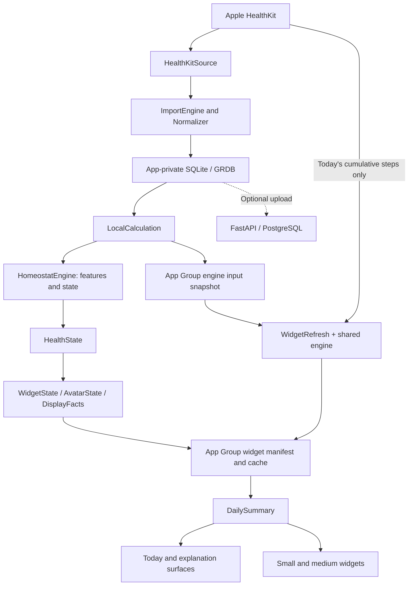
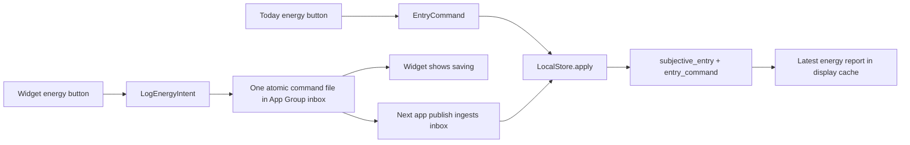

# Homeostat: the complete codebase guide

**Snapshot: October 9, 2026 · repository HEAD `2222b08` plus the working tree.**

This guide explains the product, the running system, its data, its calculations, and how to navigate and change it. It describes code that exists today and distinguishes it from specifications for later work. It is an explanation of this repository, not a new roadmap or a claim that every device acceptance check has passed.

The repository is named **Health_widgets**. The product and most modules are named **Homeostat**. They are the same project.

## Reading map

Start with sections 1–4 for the overall picture. Read 5–9 to understand data and calculations. Use 10–14 when working on the code. Section 15 explains the confusing parts and open issues.

1. [What the product does](#1-what-the-product-does)
2. [What exists and what is planned](#2-what-exists-and-what-is-planned)
3. [The architecture](#3-the-architecture)
4. [Four journeys through the system](#4-four-journeys-through-the-system)
5. [The data model](#5-the-data-model)
6. [Where data lives](#6-where-data-lives)
7. [How calculations work](#7-how-calculations-work)
8. [How results become words and an avatar](#8-how-results-become-words-and-an-avatar)
9. [Background work and widget freshness](#9-background-work-and-widget-freshness)
10. [The optional backend and API](#10-the-optional-backend-and-api)
11. [Repository and module map](#11-repository-and-module-map)
12. [Setup and everyday commands](#12-setup-and-everyday-commands)
13. [Tests, fixtures, and evidence](#13-tests-fixtures-and-evidence)
14. [Where to make a change](#14-where-to-make-a-change)
15. [Why the project feels messy and what remains](#15-why-the-project-feels-messy-and-what-remains)
16. [Glossary and document hierarchy](#16-glossary-and-document-hierarchy)

For the full navigable source and test inventory, use [SOURCE_INDEX.md](/Users/susil/Health_widgets/docs/SOURCE_INDEX.md). Links in these guides target this local checkout.

## 1. What the product does

Homeostat is an iPhone app with a Home Screen widget. It reads Apple Health data and produces a small, explainable observation about the person's day, accompanied by an avatar. The app explains the underlying readings and lets the person report their energy.

The current product answers questions such as:

- Was my main sleep shorter or longer than my usual sleep?
- Are my recovery-related measurements broadly typical, favorable, or strained relative to my own history?
- Have I recorded fewer or more steps than usual by this time?
- Did I recently complete a workout?
- Is the information current, missing, or still learning my baseline?

The result comes from deterministic rules. There is no LLM, trained prediction model, or agent on the current calculation path. There is no single global health score. “Usual” means the person's historical baseline; it does not mean a recommended target. A reported energy level stays separate from sensor-derived state.

**The phone can do the whole current job without a server:** read HealthKit → store events → calculate → publish to the widget. The Python backend still exists because it is the calculation reference, a test/replay environment, and an optional destination for uploaded history.

The app currently starts on Today. Details opens the existing Debug screen, which also provides access to Settings and avatar customization. The planned Today/Trends/Journal navigation is not fully implemented.

## 2. What exists and what is planned

“Implemented” means code exists. Physical acceptance, accessibility review, and sustained background reliability are separate questions.

| Area | Current implementation | Remaining or planned |
|---|---|---|
| Health data | Read-only sleep stages, HRV SDNN, resting heart rate, steps, completed workouts | Additional metrics and another provider |
| Import | Anchored queries, pagination, normalization, duplicates, deletions, quarantine, coverage and lost-anchor reconciliation | Remaining physical recovery checks |
| Local calculation | Pure Swift engine, baselines, confidence, drivers, local stored result | Long-history snapshot/retention fix |
| Today | Summary, avatar, domain readings/readiness, freshness, time-of-day styling, explanation access | Current-build device and accessibility acceptance |
| Explanation | Readings, comparisons, contributing evidence and expandable technical details | Exact reproduction of a widget-only step refresh is limited; see section 9 |
| Energy check-in | Low/Okay/High in app and medium widget; app acknowledgment/Undo; optional agreement answer | General journal/history/edit/delete screens; retry and day-boundary issues |
| Home Screen widget | Small and medium; shared summary, avatar, update time, stale and earlier-day handling, deep links, medium check-in buttons | W1 visual/interaction polish; focus configuration; large, Lock Screen and Control widgets |
| Widget self-refresh | Reads today's steps and recalculates using an app-prepared input snapshot | Latest-build force-quit acceptance and sustained runtime/memory evidence |
| Avatar | Code-drawn character, appearance choices, health-derived channels, lighting and fading workout effects | Final art and remaining device accessibility acceptance |
| Optional server | FastAPI/PostgreSQL, event ingestion, replay, durable recalculation, account/device authentication, pairing, widget credentials | Pairing failure fix; broader deployment work |
| Trends/activity calendar | Specifications and design studies | Native screens, retained daily summaries and day details |
| Workout authoring | Imported completed workouts only | Manual sessions, exercises, sets/reps/load, effort, resume, planning and Live Activity |
| Goals/rings | Product/design specifications | Goal persistence/versioning and native rings |
| Personalization | Future specifications | Reminders, calendar integration, agent proposals |
| Food/patterns/what-if | Future specifications | Data collection, analysis and product surfaces |
| Other platforms/providers | Provider identity helpers and architecture document | No enabled second-provider ingestion or Android/web client |

Phase names used throughout the older documents:

| Label | Meaning |
|---|---|
| G1 | Initial reliable data → calculation → widget foundation |
| G2 | Avatar model, rendering and acceptance |
| M1 | Deferred import and unlock recovery |
| M2 | Feasibility of a widget reading steps while the app is closed |
| M3 | Widget step query plus local recalculation/publication |
| P1 | Daily loop: glance → explanation → optional energy check-in |
| P1b | History, activity calendar, Journal and focused widgets |
| P2 | Workout logging, reflection, goals and related session features |
| P3 | Optional rings and personalization, reminders/calendar/agent work |
| P4 | Food context, patterns and hypothetical scenarios |
| W1–W4 | Widget roadmap stages in Product.md; these are not additional shipped widget families |

Status reference: [Plan.md](/Users/susil/Health_widgets/Plan/Plan.md). Product intent: [Product.md](/Users/susil/Health_widgets/Plan/Product.md).

## 3. The architecture

There are two native processes: the **app** and the **widget extension**. The optional API server and its worker run separately. Files in an Apple App Group let the app and widget exchange selected information.



The diagram describes logical data flow. In particular, Today constructs its display from the app's stored local result; a widget-only recalculation does not update the app database. Both surfaces use the same presentation code, but they can temporarily hold different input snapshots.

### The three Swift libraries

| Library | Job | Dependencies and boundaries |
|---|---|---|
| `HomeostatShared` | Shared time/JSON types, widget/avatar contracts, display policy, daily-summary wording, check-in commands/inbox, cache files, widget HTTP client, avatar drawing | Does not depend on GRDB or the calculation engine |
| `HomeostatEngine` | Canonical calculation inputs, feature calculations, state rules, original presentation mapping, engine settings, step snapshots and snapshot format | Depends on Shared; no database or HealthKit dependency |
| `HomeostatCore` | App-private storage, import orchestration, normalization, journal writes, outbox, upload/retry orchestration and local calculation | Depends on Shared, Engine and GRDB |

The SwiftUI app supplies actual HealthKit access, lifecycle handling, Keychain access and screens. The widget target supplies its own limited HealthKit step query, timeline provider, widget layouts and App Intent.

### The conceptual layers

1. **Canonical events:** what a provider reported.
2. **Features:** calculated numbers, such as sleep hours or usual steps by now.
3. **HealthState:** classifications and their evidence, such as `below_baseline`.
4. **WidgetState / AvatarState:** original renderable text and visual channels.
5. **DisplayFacts / DailySummary:** current native daily-loop wording, learning indicators and reported energy.
6. **Views:** arrangement, styles, gestures and navigation.

These layers are the most useful boundary when deciding where a change belongs. A color change should not change a baseline. A check-in should not rewrite a HealthKit record. A widget refresh should not make an old HRV reading appear newly observed.

### Why Python and Swift both exist

Python is the reference engine. Swift is the implementation used on the phone and by the widget. Golden fixtures compare their outputs so the phone does not quietly implement different health rules.

The original mapper also exists in both languages. The newer `DailySummary` is Swift-only and sits above it. Consequently a Python report's wording can differ from the final native daily-loop wording without the calculations disagreeing. For example, the original mapper can say “Less active than usual”; the native summary says “Fewer steps than usual by this time.”

## 4. Four journeys through the system

### A. First use and an ordinary refresh

1. `HomeostatApp` creates the app UI through `AppDelegate` and `AppModel`.
2. `AppModel` opens a scoped local SQLite store. Without server settings, the scope is `device`.
3. The person requests Health access. The app records that access was requested; it does not claim that every read permission was granted.
4. `HealthKitSource` reads sleep, HRV, resting HR and workouts through anchored queries. Steps use HealthKit statistics.
5. `ImportEngine` processes pages. `Normalizer` converts accepted values to canonical events; unsupported or invalid samples go to quarantine.
6. Each page's events, provider identity information, deletion information and new anchor commit together. A crash cannot advance an anchor past uncommitted data.
7. Completed imports record coverage and visibility membership. The import cycle uses a common cutoff, so the calculation knows how far its inputs extend.
8. `LocalStore.localRun` reads a consistent input set. `LocalEngine` calculates features and HealthState, then the original mapper builds WidgetState and AvatarState.
9. The app stores the local result, publishes its display cache and writes the matching engine-input snapshot for the widget.
10. Today and the widget render through the shared presentation rules. The app requests a timeline reload when appropriate.

A first import looks back 35 prior local days plus one overlap day for overnight intervals. That can provide a ready baseline immediately if enough usable measurements exist. “Fourteen usable days” does not necessarily mean waiting fourteen days after installation.

### B. A widget refresh while the app is closed

1. WidgetKit asks the extension for a timeline.
2. `WidgetRefresh` reads the current cache and bounded input snapshot.
3. It asks HealthKit for today's cumulative steps, with a five-second deadline.
4. If there are usable steps, `EngineSnapshot.calculate` recalculates with that new observation. Other domains remain limited to the app calculation's cutoff; their age still increases with time.
5. Scope, run identity, timezone, date and settings checks prevent mixing incompatible inputs.
6. The ordered cache writer accepts the result only if it is not older than the stored result.
7. The timeline schedules display changes such as staleness, midnight and effect fading. It requests another refresh, but that request is not a promise of exact execution time.

No usable input, no samples, timeout, incompatible snapshot, query failure or write failure leaves the prior result available. The widget does not upload, write HealthKit, or open the app's GRDB database.

### C. An energy check-in



The app writes directly to the journal transaction. The widget writes a command file because it has no database access. A command UUID makes retrying the same operation idempotent. Revision checks stop an older edit from overwriting a newer entry. Deletions are tombstones.

The widget can acknowledge the waiting file as **saving** before the app has consumed it. The app removes that file only after recording the command outcome; a failed transaction leaves it for another attempt. Saved energy appears alongside measured state and does not enter the health engine.

The store implements create/edit/delete/undo commands. Today's visible Undo uses a delete command for the most recent app-created report. A full history/editor interface is not built.

### D. Optional server upload

1. Server settings register or pair a device and establish a scoped account connection.
2. Upload must also be enabled. Health access and upload are separate choices.
3. The local outbox creates an immutable request and stores its exact bytes before sending.
4. `SyncEngine` sends it to `/v1/health/sync` with the device token.
5. The server validates events individually, records receipts and assigns an input revision when needed.
6. Input writes and a durable recalculation job commit together. Recalculation is attempted inline and can be resumed by the worker.
7. Retries use the same request and event IDs. A lost HTTP response does not mean the server failed to store the upload.
8. Server-derived state is stored separately from the app's local state. The active native result path continues to use the on-device result.

## 5. The data model

### Five event shapes, five measurement domains

Do not confuse **event shape** with **measurement domain**. HRV and resting HR share the point-measurement shape; deletion is an event shape but not a measurement.

| Canonical `event_type` | Important fields | What it represents |
|---|---|---|
| `point_measurement` | `metric`, `observed_at`, positive `value`, `unit`, metadata | `hrv_sdnn_ms` in milliseconds or `resting_hr_bpm` in beats/minute |
| `interval` | `kind=sleep_stage`, stage `value`, `start_at`, `end_at`, metadata | In-bed, awake, unspecified/core/deep/REM sleep intervals |
| `workout` | `workout_type`, `start_at`, `end_at`, `duration_minutes`, metadata | A completed workout; active duration may be shorter than elapsed duration |
| `daily_activity_snapshot` | `day`, `timezone`, `as_of`, `queried_at`, `steps` | Cumulative steps from that local day's start to a cutoff |
| `delete` | `source_record_id`, `deleted_at` | The adapter observed a deleted provider record |

Common fields are `schema_version`, client `event_id`, `source`, and `source_record_id`. The active canonical contract uses `source="healthkit"` and schema `1.0.0`.

Sample metadata preserves HealthKit type, source display name, bundle ID, optional source revision/product type, original sample start/end, IANA timezone and how that timezone was chosen. Other metadata is retained as string key/value pairs. If the sample lacks timezone metadata, normalization uses the ingestion device's timezone and retains that provenance; previously assigned fallback zones are preserved for rereads.

Source definitions: [Python contracts](/Users/susil/Health_widgets/backend/app/contracts/canonical_events.py), [Swift canonical models](/Users/susil/Health_widgets/ios/HomeostatCore/Sources/HomeostatEngine/CanonicalEvent.swift), [Normalizer](/Users/susil/Health_widgets/ios/HomeostatCore/Sources/HomeostatCore/Normalizer.swift).

### Identity: several IDs solve different problems

| Identifier | Purpose |
|---|---|
| `source_record_id` | Provider identity: usually a HealthKit sample UUID, or a constructed step-read identity |
| `event_id` / `client_event_id` | One client event, retained across retries |
| Content hash | Logical provider content, excluding the client's event ID; detects identical rereads and contradictions |
| `request_id` | One exact upload batch; retrying it reuses its stored bytes |
| `installation_id` | Which installation observed provider records and completed a visibility scan |
| `input_revision` | Which input generation a result used; local and server revisions come from different stores |
| `run_id` | One calculation execution/publication within its relevant store |
| `scope` | Separates device-only or backend/account state, queues and widget files |
| `command_id` / `entry_id` | One journal operation versus the user-reported entry it changes |

On the server, provider identity includes user, source, record ID and event type; content distinguishes stored versions. Receiving identical data adds no measurement weight. Contradictory versions are retained and excluded from calculation rather than silently choosing one.

A step-read identity includes timezone, day, cutoff, query time **and total**. For the same bucket, the latest query wins even if the corrected total is lower. Conflicting totals at the same newest query time leave the bucket unresolved until a newer unambiguous read arrives. The algorithm does not simply choose the largest number.

### Time: measurement time is not arrival time

| Time field | Meaning |
|---|---|
| `observed_at`, sample/interval start and end | When the underlying observation happened |
| `as_of` | How far a cumulative step total covers |
| `queried_at` | When HealthKit's statistics were read; later reads can correct prior buckets |
| `delivered_at` / server `received_at` | When this system learned about an event |
| `effective_at` | The moment the result describes |
| `known_at` | The information-availability cutoff for replay |
| `cutoffs[domain]` | Optional domain-specific observation/coverage cutoff |
| `event_at` on a check-in | When the person reported their energy |
| Journal created/updated time | When a report or edit was persisted |

Example: sleep occurred overnight but arrived at 11 a.m. A replay of what was known at 9 a.m. must not use that delivery. A later retrospective reconstruction can use it and may revise the earlier interpretation.

Instants are ordered in UTC. Local-day membership uses IANA timezones, not just numeric offsets. Sleep belongs to its wake day. A day's closing step snapshot belongs to the day being closed, even though its cutoff is the next day's first instant. Device display uses the phone's current timezone; synthetic defaults do not dictate the product timezone.

### Coverage, visibility, deletion and quarantine

These are different concepts:

- **Coverage:** a query completed for a domain over a declared interval, or the interval was unavailable. Later revisions supersede older declarations. A calculation only demands coverage through its cutoff.
- **Visibility scan:** the records visible to an installation during a complete reread. A missing member can be withdrawn from calculation; that is not proof it was deleted globally.
- **Deletion/tombstone:** an explicit record of a provider deletion. It remains effective even if the original event arrives later.
- **Quarantine:** a sample was unsupported, malformed or contradictory and cannot safely be used. Raw repair information is retained locally where supported; unresolved quarantine can prevent declaring coverage complete.

HealthKit read authorization is intentionally opaque to the app: successful empty queries do not prove that permission was granted or that nothing happened. The ledger uses requested/visibility information rather than inventing a granted/denied determination.

**Existing exception to ideal missing-data handling:** the app's hourly step importer represents empty buckets as zero. The native UI words this as “No steps recorded yet.” The widget's newer direct query instead distinguishes `noSamples` and keeps its cache. That inconsistency is an acknowledged open data-contract decision.

### Derived outputs

| Output | Contents |
|---|---|
| `DailyFeatures` | Per-domain numeric values, baselines, readiness, classifications, confidence and observation references |
| `CalculationReport` in Python | Features plus settings, context, input hash, evidence and diagnostics |
| `HealthState` | Sleep/recovery/movement/workout state, calibration, versions and explanatory drivers |
| Driver | ID, domain, value, baseline, difference, unit, source, observation time and confidence |
| `WidgetState` | Presentation strings/icon, primary trait, effective/update times and avatar |
| `AvatarState` | Eyes, posture, movement, activity, effects, uncertainty and evidence references |
| `DisplayFacts` | Domain state/support, learning-day counts and measurements needed by native presentation |
| `DailySummary` | Waiting/learning/change/quiet/earlier-day/unavailable state, headline/comparison, domain lines, action, freshness and optional report |

A driver is the bridge from an interpretation back to its evidence. A value-bearing driver must carry a unit, source and observation time. Baseline differences must equal value minus baseline.

## 6. Where data lives

### Runtime storage map

| Location | Actual contents | Owner |
|---|---|---|
| App Application Support, `homeostat-<scope>.sqlite` | Imported events, anchors, queue, coverage, current local state and subjective journal | App via GRDB |
| App Group `group.com.susil.homeostat`, `widget/widget_state.json` | Schema-2 manifest containing configuration/fetch metadata and nested schema-1 `WidgetCache` | Coordinated app/widget access |
| App Group `engine/engine_inputs.json` | Versioned header plus delivery-time/event lines for widget calculation | App writes; widget reads |
| App Group `inbox/<scope>/<command UUID>.json` | Pending check-in commands | Widget writes; app applies/removes |
| App Group `avatar/identity.json` | Appearance choices | App writes; app/widget read |
| App Group probe log | Diagnostic refresh/import evidence | Native diagnostic paths |
| Keychain | Device/API credentials and widget credentials | Credential code |
| UserDefaults | Settings, selected connection/store mapping, upload preference and registration bookkeeping | App |
| Optional PostgreSQL | Uploaded events, receipts, coverage, account/device records and calculation history | Backend |
| Repository `data/synthetic` | Fictional reproducible input corpus | Development/test generator |

The engine input file has a `.json` name but is **not a single ordinary JSON object**: it contains one JSON header line, then lines containing delivery time, a tab and canonical event JSON. It carries health observations. Older statements that the widget receives only display data describe the pre-M3 architecture, not all current App Group files.

The app marks Application Support excluded from backup and applies file protection until first user authentication to its database. Shared cache/snapshot/inbox writes use the corresponding protected atomic-write option. These source-level settings are not substitutes for the open physical locked-device checks.

### Local SQLite tables

The schema lives in [LocalStore.swift](/Users/susil/Health_widgets/ios/HomeostatCore/Sources/HomeostatCore/LocalStore.swift). Journal operations live in [Journal.swift](/Users/susil/Health_widgets/ios/HomeostatCore/Sources/HomeostatCore/Journal.swift).

| Table | Key or identity | Purpose |
|---|---|---|
| `authorization_ledger` | Type | Access-request time, status/error and first/last visible sample times |
| `query_anchors` | Type + predicate version | Durable HealthKit continuation token |
| `provider_records` | Record ID + event type + content hash | Deduplication index linking provider content to client events |
| `deletions` | Record ID | Known provider tombstones |
| `step_buckets` | Zone + day + cutoff | Last imported total for change detection |
| `quarantine` | Row ID; unique domain/record/reason | Failed samples, repair payload, sample times and resolution |
| `event_outbox` | Row ID; unique client event ID | Canonical event bytes and upload state; also the local event log used for calculation |
| `coverage_outbox` | Row ID | Coverage declarations and dependencies on durable event delivery |
| `upload_requests` | Request UUID | Immutable body, included row IDs, attempts, next retry and terminal/paused state |
| `sync_state` | String key | Import lower bound/cutoffs, generations, counters, errors, stored local/server state and diagnostic metadata |
| `provider_timezones` | Record ID | First assigned fallback timezone so rereads remain stable |
| `generation_members` | Type + generation + record ID | Records seen by a complete scan generation |
| `visibility_outbox` | Row ID; unique scan ID | Pending installation-scoped visibility scans |
| `subjective_entry` | Entry UUID | Energy value, event time/zone, created/updated times, revision, deletion flag, agreement answer/run reference |
| `entry_command` | Command UUID | Recorded operation outcome and prior value/deletion state for idempotency/undo |

`event_outbox` is particularly easy to misunderstand. “Acknowledged” does not mean the health event is removed from local history. These rows still feed local calculation. The name reflects its original upload role; it now also functions as the event ledger.

Local migrations are append-only: `v1`, `v2_repairable_imports`, `v3_visibility_scans`, `v4_installation_visibility`, `v5_release_dead_letter_scans`, `v6_subjective_entries`. There is no implemented `v7_history` or local `daily_summary` table yet.

### Optional PostgreSQL tables

Definitions are in [db.py](/Users/susil/Health_widgets/backend/app/db.py); Alembic migrations are authoritative for the live database.

| Table | Purpose |
|---|---|
| `users` | Account identity, current timezone and accepted input revision |
| `devices` | Device identity, account ownership, token hash and revocation |
| `pairing_codes` | Hashed temporary pairing code, creator, expiry and consumer |
| `widget_credentials` | Read-only widget-token hash, provisioning operation, installation/device ownership and revocation |
| `sync_requests` | Request body hash, accepted revision, counts and recorded response |
| `health_events` | Unique provider-content versions with queryable times and full JSON payload |
| `event_receipts` | Permanent per-client-event outcome: accepted, duplicate, conflict or rejected |
| `coverage_declarations` | Complete/unavailable domain intervals at input revisions |
| `visibility_scans` | Installation/type scan bounds and member record IDs |
| `installation_records` | Append-only evidence that a particular installation saw a record |
| `recalc_jobs` | Durable pending/done recalculation jobs, attempts and retry timing |
| `config_snapshots` | Immutable resolved settings keyed by SHA-256 |
| `calculation_runs` | Day, zone, effective/known time, revision and versioned run identity |
| `run_outputs` | Feature report, HealthState, WidgetState and input hash for each run |

Migrations `0001`–`0006` add the initial schema, partial-day coverage, visibility scans, installation visibility, widget credentials and device authentication respectively. The backend retains an explicit run history; the phone currently keeps its current local result in `sync_state`, not an equivalent full native history UI/store.

## 7. How calculations work

The main Python entry point is [calculate_features](/Users/susil/Health_widgets/backend/app/features/calculate.py). The Swift counterpart is [Features.swift](/Users/susil/Health_widgets/ios/HomeostatCore/Sources/HomeostatEngine/Features.swift).

### First: decide which observations are eligible

Selection filters by knowledge time, collapses repeated deliveries, removes tombstoned records, applies visibility reconciliation and excludes conflicting provider versions. Domain code then applies observation cutoffs, source priority and the appropriate day/time rules.

Source priority in the checked-in settings is Apple Watch, synthetic watch, Apple iPhone, synthetic phone, synthetic sleep app, then unknown sources in stable lexical order. The synthetic entries exist for fixtures. Matching uses bundle/product metadata. Default source weights are all 1. This is deterministic source preference, not a learned source-quality score.

### Personal baselines

For sleep, HRV, resting HR and movement:

- Look at the previous **28 calendar days**, excluding the report day.
- Require at least **14 usable days** for that domain/comparison.
- Use the **median**, which is less sensitive to an extreme day than a mean.
- Keep missing days missing; they do not become zero-valued observations.

Readiness is per domain. One missing HRV history need not block a valid sleep comparison. The overall calibration summary uses the minimum usable-day count among domains with at least one usable day; domain-specific counts remain the more informative product signal.

### Sleep

1. Group intervals by source group and timezone.
2. Cluster asleep/awake stages separated by at most 90 minutes. In-bed records cannot create sleep or bridge two episodes.
3. Union overlapping asleep intervals, then subtract overlapping awake intervals from the same source group.
4. Select the highest-priority group with an eligible overnight episode, then its longest episode by actual asleep duration. The overnight window is previous-day 18:00 through wake-day 12:00; eligibility is overlap with that window.
5. Compare with historical primary episodes from the selected group. Other episodes remain evidence but are not added to the main sleep duration.

```text
delta_minutes = (today_sleep_hours - baseline_sleep_hours) × 60
below_baseline if delta_minutes <= -60
above_baseline if delta_minutes >= +60
otherwise typical
severity = min(abs(delta_minutes) / 120, 1)
```

Example, assuming enough history and coverage: 6 hours today versus an 8-hour median gives −120 minutes, `below_baseline`, and severity 1. The number means shorter than personal usual; it is not a diagnosis or a prescribed sleep duration.

### HRV and resting heart rate

Choose one reading per day within the selected source group: latest reading inside primary sleep; otherwise first after waking on that local day; if no primary sleep exists, first reading of that local day. This is a selected reading, not an average of every measurement.

```text
center = median(historical daily readings)
MAD = median(abs(reading - center))
robust_z = (current - center) / max(1.4826 × MAD, 1.0)
```

The floor is 1 ms for HRV and 1 bpm for resting HR. It avoids division by zero or an exaggerated result when past variation is tiny.

| Robust z | State |
|---|---|
| `< -1` | `below_usual` |
| `-1` through `+1`, inclusive | `typical` |
| `> +1` | `above_usual` |

The app specifically imports HRV **SDNN**. Other HRV methods are not interchangeable inputs to this contract.

### Movement

Steps come from HealthKit's merged statistics, avoiding a naive sum of watch and phone samples. Hourly sums are turned into cumulative snapshots.

Current steps are compared to the median historical cumulative total at the same local wall-clock position. Each historical day needs a bucket at or up to 60 minutes before that position. Matching uses local wall time across zones/DST, with deterministic bucket tie-breaking; it is not a comparison against a fixed daily goal.

```text
ratio = current_steps / expected_steps_by_now
behind_usual if ratio < 0.70
ahead_of_usual if ratio > 1.30
otherwise typical
```

If the expectation is zero, ratio is absent and the state is typical when a current value exists. If no usable current bucket exists, a ready baseline produces `missing`.

Example: 3,000 recorded steps versus 5,000 usual steps by now gives 0.60 and `behind_usual`. It does not prove sitting or lack of exercise; a cycling workout may explain why steps are low.

### Workouts

Only completed workouts are imported. The schema reserves `active`, but the current engine rejects active workout input.

- Up to and including 2 hours after completion: `just_completed`.
- More than 2 and up to and including 12 hours: `recent_workout`.
- Beyond 12 hours, or a known absence of recent workouts: `none_recent`.
- Unavailable/conflicted required workout history: `missing`.

Today and seven-day totals avoid double counting overlapping sessions: split overlap into time segments and choose a source winner. Active minutes are allocated proportionally across elapsed time because actual pause locations are not available. This also handles workouts crossing midnight. Completed-session duration is not a training-load or muscle-fatigue model.

### Recovery combines evidence; it does not add steps

Usable recovery inputs are sleep, HRV and resting HR with ready baselines, current classifications and confidence above zero.

| Rule | Recovery state |
|---|---|
| Fewer than two usable inputs | `insufficient_data`, confidence 0 |
| At least two adverse inputs: shorter sleep, below-usual HRV, above-usual resting HR | `strained` |
| Above-usual HRV and below-usual resting HR, without usable below-baseline sleep | `favorable` |
| Other usable combinations | `typical` |

```text
recovery_confidence = min(used input confidences) × number_of_used_inputs / 3
```

Two full-support inputs therefore produce confidence 2/3. A single unusual HRV reading cannot independently produce a strained or favorable recovery result. Sleep can contribute to recovery and also appear as its own domain.

### Confidence and freshness are separate from medical probability

For the four baselined input domains:

```text
confidence = maturity × freshness × current-day coverage × source weight
maturity = min(usable_days / required_days, 1)
```

No current value gives zero confidence. Freshness stays full to a threshold, then falls linearly to zero:

| Domain | Full support through | Zero freshness at |
|---|---|---|
| Sleep, HRV, resting HR | 24 hours | 48 hours |
| Movement | 1 hour | 3 hours |

Workout confidence is 1 when the required history is usable/covered and 0 when unavailable. The original mapper generally requires confidence at least 0.5 for a displayed interpretation. Plain readings can still appear while learning, with readiness and observation time shown.

**The widget's 90-minute stale styling is a different policy.** It measures age of the published result, not the above measurement-support decay.

### Configuration and versioning

Python loads [homeostat.yaml](/Users/susil/Health_widgets/backend/config/homeostat.yaml), validates defaults and hashes the resolved settings. Swift uses immutable [EngineSettings.standard](/Users/susil/Health_widgets/ios/HomeostatCore/Sources/HomeostatEngine/EngineSettings.swift) with the same canonical settings identity. Editing YAML does not remotely reconfigure an installed phone; a rule change needs an intentional Swift update and parity verification.

| Contract/layer | Current identifier |
|---|---|
| Canonical event schema | `1.0.0` |
| Feature contract | `features@0.2.0` |
| Calculation policy | `features-calc@0.1.0` |
| Feature report | `feature-report@0.1.0` |
| HealthState contract | `health-state@0.1.0` |
| State engine | `state-engine@0.1.0` |
| Original presentation mapper | `presentation@0.2.0` |
| WidgetState contract | `widget-state@0.2.0` |
| Engine input snapshot | `engine-inputs@1` |
| Native daily summary | `daily-summary@1` |

These versions serve different purposes. Copy changes should not silently change calculation settings; event-schema changes need coordinated parsing/fixture updates. The snapshot currently records a format version and settings hash, not every proposed identity field mentioned in design documents.

## 8. How results become words and an avatar

### Original mapper priority

The original Python/Swift mapper ranks supported interpretations in this order:

1. Shorter sleep.
2. Strained recovery.
3. Fewer steps/behind usual movement.
4. Just-completed workout.
5. Longer sleep.
6. Favorable recovery.
7. More steps/ahead of usual movement.
8. Recent workout.
9. Fallback calibration, typical, or waiting state according to available evidence.

This explains why a workout can appear as secondary information when short sleep wins the headline. It is fixed policy, not a learned importance ranking.

### Native DailySummary

[DailySummary.swift](/Users/susil/Health_widgets/ios/HomeostatCore/Sources/HomeostatShared/DailySummary.swift) takes display policy plus cache facts and a possible energy report. It adds per-domain learning lines, same-domain comparisons, quieter typical-day language, and safer steps wording.

Its six kinds are `waiting`, `learning`, `change`, `quiet`, `earlier_day` and `unavailable`. Stale is a flag on a retained result, not a fabricated new reading. Ready domains can remain useful while other domains are learning.

The recovery row combines HRV/resting-HR display facts and uses their available learning counts; the underlying recovery engine can also use sleep. Read the contributing drivers when interpreting recovery, rather than treating that row as an independent raw metric.

### Avatar channels

| Channel | Current basis |
|---|---|
| Eyes | Sleep deviation; intensity uses severity × confidence |
| Posture | Recovery strained/favorable/neutral |
| Motion | Movement behind/typical/ahead |
| Activity appearance | Recognized completed workout type group |
| Sweat/glow | Time-decaying workout effects |
| Uncertainty marker | Calibration or insufficient display support |
| Skin/hair/style/glasses | User-selected appearance, stored separately |
| Lighting | Local time of day |

Effects decay from the workout's recorded completion time, not from widget refresh time. Current half-lives are 20 minutes for sweat and 160 minutes for glow, with a 0.05 cutoff. The widget creates discrete timeline entries for changes; it does not run a continuous animation loop. The app can animate its live avatar.

The current artwork is drawn by code in `AvatarView.swift`/`AvatarPainter`. Final art remains a separate task. Redaction neutralizes health-expressive avatar traits as well as text; otherwise hidden text could still be revealed by a tired-looking character.

## 9. Background work and widget freshness

### Three update paths

| Path | Trigger and behavior | Important limitation |
|---|---|---|
| App import/calculation | App launch/foreground, HealthKit observer or refresh task | Background scheduling is best effort |
| Deferred-import recovery | Protected data becomes available or a later catch-up | Needs a later opportunity to run; a force-quit app is a separate case |
| Widget self-refresh | Widget timeline request, today's steps plus app snapshot | Updates steps only; depends on valid same-day snapshot and query access |

`AppModel` coordinates lifecycle tasks and cancellation. `ImportEngine` coalesces overlapping work so a second caller shares an import instead of duplicating it. Local calculations also coalesce. `BackgroundSyncRunner` bounds optional upload passes; foreground retry scheduling is separate.

### Cache order prevents older work winning a race

[SharedWidgetStore.swift](/Users/susil/Health_widgets/ios/HomeostatCore/Sources/HomeostatShared/SharedWidgetStore.swift) coordinates shared-file reads/writes with `NSFileCoordinator` and atomic replacement.

For a scope, compare `(input_revision, run_id)` first, then `steps_through` within the same run. A newer app run wins over an older widget run. A newer widget step read wins over an older read of that same run. Republishing the same app run does not erase newer widget steps; an app energy-report update can merge into that cache.

These fields must not be compared across unrelated scopes or confused with a universal sequence shared between local SQLite and PostgreSQL.

### Display policy

- No cache: waiting state.
- Unsupported/unreadable cache: safe open-app message.
- Current-day result: keep supported content.
- More than 90 minutes old: stale styling and update time.
- Result from another local day: earlier-result state, not today's conclusion.
- Timezone change: require both the stored day and effective instant to match the current local day before calling it current.

The widget typically requests another timeline around 15 minutes when an input file exists, otherwise around 30 minutes or an appropriate retry/day boundary. These are requested intervals, not guaranteed cadence.

### Current M3 limits

The snapshot reader and writer enforce **2,000,000 bytes**. The present input path parses the full retained event log; it does **not** implement the rolling 36-day/event-count bound proposed in some plans. An oversized write deletes the old snapshot, leaving the cache usable but disabling further widget recalculation until valid inputs can be written. The proposed compact-summary fallback is not implemented.

The HealthKit query can wait five seconds; a proposed three-second whole-refresh target is therefore not a hard current guarantee. Device timing and sustained use still need evidence.

### Explanation links are bounded by what is stored

The widget uses `homeostat://explain` with scope/run context. The app resolves the current matching result, a newer result with a notice, or an unavailable/invalid-link state.

After a widget-only step recalculation, the app still has its last full local run. It explicitly says the widget counted steps later and shows the app's last full calculation. That is not an exact persisted replay of the widget-only result. Also, native local storage is not a permanent ledger of every prior explanation; the optional server has the fuller run ledger.

## 10. The optional backend and API

The stack is Python 3.12+, FastAPI, Pydantic, SQLAlchemy Core, psycopg, PostgreSQL 16, Alembic and Uvicorn. Dependencies are declared in `pyproject.toml` and locked by `uv.lock`. The API starts a recalculation worker unless the configured interval is zero; a standalone worker command is also provided.

### Authentication roles

| Credential | Role |
|---|---|
| Enrollment key, `HOMEOSTAT_API_KEY` | Create an account/device; required for API runtime startup |
| Per-device random token | App API authentication through `Authorization: Bearer …`; server stores hash |
| Pairing code | Add another device to an account; eight characters, ten-minute lifetime, single use |
| Widget token | Separate read-only access to the compact widget endpoint |
| Development `X-Homeostat-Key` | Enrollment key can also authenticate the development user only in development mode |

Account scope is tied to verified server/account identity. Device revocation also revokes its provisioned widget credentials. First-account enrollment has legacy development-user adoption behavior. This is device-key/pairing authentication, not email/password or Sign in with Apple.

### Endpoint catalog

| Method and route | Authentication | Purpose |
|---|---|---|
| `POST /v1/accounts` | Enrollment key | Create/register account and first device |
| `GET /v1/account` | App/device | Return stable account ID |
| `POST /v1/pairing-codes` | Device | Create a temporary pairing code |
| `POST /v1/devices/pair` | Pairing code in request | Register another device |
| `GET /v1/devices` | Device | List active devices and identify caller |
| `DELETE /v1/devices/{device_id}` | Device/account ownership | Revoke a device and its widget credentials |
| `POST /v1/health/sync` | App/device | Accept events, coverage and visibility declarations |
| `GET /v1/state/current` | App/device | Latest state, with `is_today`; 404 if none exists |
| `GET /v1/state/{day}` | App/device | Latest state for a day, with finalized indication |
| `GET /v1/state/runs/{run_id}` | App/device ownership | Exact stored run explanation |
| `GET /v1/debug/features/{day}` | App/device; development only | Stored feature report |
| `POST /v1/widget/credentials` | App/device | Idempotently provision widget credential |
| `DELETE /v1/widget/credentials/{operation_id}` | App/device ownership | Revoke widget credential |
| `GET /v1/widget/current` | Widget token | Compact read-only publication and calculation status |
| `GET /healthz` | None | Check database availability |

### Upload and retry semantics

The server allows 500 events and a 5 MiB streamed body per sync request. The client normally builds batches of 250 events and up to 4 MiB. Events are validated individually, so one bad record need not invalidate all otherwise valid records.

| Outcome | Client behavior |
|---|---|
| Accepted/duplicate event | Mark acknowledged; retain local event history |
| Provider-content conflict | Record conflict instead of silently choosing a version |
| Permanent invalid event | Dead-letter record for inspection |
| Network loss / 429 / 5xx | Retry with persisted exponential backoff/jitter; respect a longer numeric `Retry-After` |
| 401 | Pause for credential repair |
| Request-ID reuse conflict, 409 | Pause the request |
| 413 | Split/reduce the request |
| 422 invalid request | Quarantine the request |
| Malformed successful response | Treat as protocol failure and retain retryable durable state |

Retry backoff starts around two seconds and is capped around five minutes before a longer server retry instruction. A request body's identity is immutable. Visibility finalization for an installation follows event acknowledgments and does not mix those finalization scans with events in the same request.

### Recalculation and replay

Inputs and the recalculation job commit together. Per-user locking serializes critical work; pending jobs can merge toward the newest revision. Results are ordered by revision/run identity, so a slow old computation does not become the latest publication.

The recalculation window reaches up to 35 days back. Historical days use their closing boundaries; today uses an import-aware cutoff. A sweep creates finalization work after midnight. `calculation_runs`, `run_outputs` and `config_snapshots` retain what is needed to rerun and compare results.

The normal widget's server-fetch flag stays disabled in on-device mode, even though `WidgetClient` and provisioning code remain present. The mere existence of networking code does not mean today's widget depends on a server.

## 11. Repository and module map

```text
Health_widgets/
├── README.md                  Entry point
├── docs/                      This guide and source inventory
├── ios/
│   ├── Homeostat/             Xcode app and widget targets
│   │   ├── Homeostat/App/     Lifecycle/state orchestration and credentials
│   │   ├── Homeostat/HealthKit/
│   │   ├── Homeostat/Views/   Today, explanation, debug/settings, avatar
│   │   └── HomeostatWidget/   Timeline, step refresh, check-in intent
│   └── HomeostatCore/
│       ├── Sources/           Shared, Engine and Core libraries
│       └── Tests/             Swift unit, parity, replay and rendering tests
├── backend/
│   ├── app/                   Reference engine, API and tooling
│   ├── config/                Calculation policy
│   ├── migrations/            PostgreSQL schema history
│   └── tests/                 Contracts through end-to-end API tests
├── data/synthetic/            Fictional demo and isolated scenarios
├── Plan/
│   ├── Plan.md                Current status/evidence tracker
│   ├── Product.md             Product experience and future scope
│   ├── specs/                 Contracts, designs, reviews and architecture
│   └── archive/               Earlier plans, trackers and visual records
├── .github/workflows/ci.yml   Backend/native CI
└── docker-compose.yml        Local PostgreSQL and optional API service
```

### Native entry points worth reading first

| File | Responsibility |
|---|---|
| [HomeostatApp.swift](/Users/susil/Health_widgets/ios/Homeostat/Homeostat/HomeostatApp.swift) | Root Today screen, scene transitions and URL handling |
| [AppDelegate.swift](/Users/susil/Health_widgets/ios/Homeostat/Homeostat/App/AppDelegate.swift) | Background task registration and protected-data notifications |
| [AppModel.swift](/Users/susil/Health_widgets/ios/Homeostat/Homeostat/App/AppModel.swift) | Main-actor coordinator: connection/store, imports, uploads, calculation, cache, energy actions, diagnostics, navigation |
| [HealthKitSource.swift](/Users/susil/Health_widgets/ios/Homeostat/Homeostat/HealthKit/HealthKitSource.swift) | Real HealthKit queries and raw sample conversion |
| [ImportEngine.swift](/Users/susil/Health_widgets/ios/HomeostatCore/Sources/HomeostatCore/ImportEngine.swift) | Durable/coalesced import cycle and incremental history repair |
| [LocalCalculation.swift](/Users/susil/Health_widgets/ios/HomeostatCore/Sources/HomeostatCore/LocalCalculation.swift) | Database → consistent LocalInputs → local run |
| [Features.swift](/Users/susil/Health_widgets/ios/HomeostatCore/Sources/HomeostatEngine/Features.swift) | Feature implementation and selection in Swift |
| [StateEngine.swift](/Users/susil/Health_widgets/ios/HomeostatCore/Sources/HomeostatEngine/StateEngine.swift) | HealthState and original widget/avatar mapping |
| [HomeostatWidget.swift](/Users/susil/Health_widgets/ios/Homeostat/HomeostatWidget/HomeostatWidget.swift) | Timeline entries, cache policy and small/medium layouts |
| [WidgetRefresh.swift](/Users/susil/Health_widgets/ios/Homeostat/HomeostatWidget/WidgetRefresh.swift) | Widget's bounded step query and recalculation attempt |

### Backend entry points worth reading first

| File/group | Responsibility |
|---|---|
| `contracts/` | Strict immutable canonical/feature/state/avatar/widget schemas |
| `config.py`, `features/` | Validated settings, selection, coverage and numeric feature calculations |
| `engine.py`, `presentation.py` | Interpretation, drivers, ranking, strings and avatar channels |
| `pipeline.py` | Run a synthetic checkpoint or timeline through all layers |
| `main.py`, `accounts.py`, `widget_api.py` | API routes, auth and bounded request handling |
| `ingest.py`, `store.py`, `db.py` | Upload validation/idempotency, persistence operations and schema |
| `recalc.py`, `worker.py` | Durable calculation, retries and day finalization |
| `replay.py` | Verify stored backend runs or rebuild daily results |
| `device_check.py` | Reconstruct results from an exported phone SQLite database |
| `experience_audit.py` | Retrospective daily headline/usefulness review reports |
| `synthetic/` | Fictional scenario definitions, generation and managed artifacts |
| `providers/identity.py` | Future provider-neutral record/series identity and duplicate-resolution helpers; not an enabled provider adapter |

Every source file and test file has a direct link in [SOURCE_INDEX.md](/Users/susil/Health_widgets/docs/SOURCE_INDEX.md).

## 12. Setup and everyday commands

These commands document the checked-in configuration; they do not imply a server or device was started while writing this guide.

### Native project

Open [Homeostat.xcodeproj](/Users/susil/Health_widgets/ios/Homeostat/Homeostat.xcodeproj) in Xcode and select the `Homeostat` scheme. The current Xcode project declares **iOS 27.0** deployment; the package separately declares iOS 17/macOS 14 minimums. The package minimum does not mean the current app supports iOS 17.

Use an Xcode installation with the SDK required by the project. Physical-device signing needs the matching app/widget/App Group entitlements. The tracked project constraints describe a free Personal Team setup and periodic re-signing. HealthKit/background acceptance needs the actual phone; a simulator build alone is insufficient.

Run package tests:

```bash
cd /Users/susil/Health_widgets/ios/HomeostatCore
swift test
```

Build the app and embedded widget for a simulator without signing:

```bash
cd /Users/susil/Health_widgets/ios/Homeostat
xcodebuild -project Homeostat.xcodeproj -scheme Homeostat \
  -destination 'generic/platform=iOS Simulator' \
  -configuration Debug CODE_SIGNING_ALLOWED=NO build
```

### Backend without a database

```bash
cd /Users/susil/Health_widgets/backend
uv sync --locked
uv run pytest -m 'not db' -q
uv run python -m app.pipeline run \
  --dataset ../data/synthetic/scenarios/short_sleep --checkpoint evaluation
```

To see just feature calculation or a demo timeline:

```bash
uv run python -m app.features calculate \
  --dataset ../data/synthetic/scenarios/typical --checkpoint evaluation
uv run python -m app.pipeline timeline --dataset ../data/synthetic/demo
```

### Optional local database and API

From the repository root:

```bash
cd /Users/susil/Health_widgets
docker compose up -d db
```

Then in the backend directory:

```bash
cd /Users/susil/Health_widgets/backend
uv sync --locked
uv run alembic upgrade head
HOMEOSTAT_API_KEY=replace-with-a-local-development-key \
  HOMEOSTAT_ENV=development \
  uv run uvicorn app.main:app --host 0.0.0.0 --port 8000
```

The example key is a placeholder. Compose maps PostgreSQL to host port 5433. An iPhone connecting over the LAN needs the Mac's reachable LAN address; `localhost` on the phone means the phone itself. The app accepts plain HTTP only in its Debug configuration; Release settings require HTTPS.

The Compose API profile is an alternative:

```bash
cd /Users/susil/Health_widgets
HOMEOSTAT_API_KEY=replace-with-a-local-development-key \
  docker compose --profile api up -d --build
```

The API container migrates on startup. Its health-data uploads are still optional from the app.

| Environment variable | Meaning/default |
|---|---|
| `DATABASE_URL` | SQLAlchemy PostgreSQL URL; default local Compose DB at port 5433 |
| `HOMEOSTAT_API_KEY` | Required enrollment key for API startup |
| `HOMEOSTAT_DEV_USER_ID` | Legacy development account identity |
| `HOMEOSTAT_ENV=development` | Enables development auth/debug endpoint |
| `HOMEOSTAT_CONFIG` | Calculation settings path |
| `HOMEOSTAT_WORKER_INTERVAL_SECONDS` | Worker interval, default 30; zero disables in-process worker |

Run database tests with PostgreSQL available:

```bash
cd /Users/susil/Health_widgets/backend
uv run pytest -q
```

Tests create disposable databases rather than running against the development tables. They need credentials allowed to create/drop those test databases and fail when PostgreSQL is unreachable.

### Replay and local data review

Server-side commands, from the backend directory:

```bash
uv run python -m app.worker --once
uv run python -m app.replay runs --user dev --from 2026-09-01 --to 2026-09-30
uv run python -m app.replay rebuild --user dev --from 2026-09-01 --to 2026-09-30
```

`runs` verifies recorded runs. `rebuild` creates new derived server records; it is not a read-only report command.

For a separately exported phone database, substitute its actual absolute path and the intended IANA timezone:

```bash
uv run python -m app.device_check /absolute/path/to/export.sqlite \
  --zone America/Chicago --out /tmp/homeostat-python-replay.json
uv run python -m app.experience_audit /absolute/path/to/export.sqlite \
  --zone America/Chicago --days 30 --out-dir /tmp/homeostat-new-review
```

The zone above is an example, not a product default. `experience_audit` requires a new output directory and produces `report.json`, `checkpoints.json` and `review.md`. These reports can contain actual personal observations; they are distinct from the fictional checked-in corpus.

A retrospective audit uses retained/corrected data at fixed local-hour checkpoints. It does not establish what the widget actually displayed or when a person saw it. Swift `DeviceReplayTests` can use `HOMEOSTAT_DEVICE_DB`, `HOMEOSTAT_DEVICE_CHECKPOINTS`, `HOMEOSTAT_DEVICE_OUT` and `HOMEOSTAT_DEVICE_ZONE` to compare the same exported inputs.

## 13. Tests, fixtures, and evidence

### Backend suites

| Directory | Coverage |
|---|---|
| `tests/contracts` | Valid and invalid event/state schemas and consistency invariants |
| `tests/synthetic` | Generator/scenario facts, determinism and artifact hashes |
| `tests/features` | Sleep/point/movement/workout calculations, selection, coverage and cutoffs |
| `tests/engine` | Recovery matrix, state interpretation, presentation combinations, parity/demo fixtures |
| `tests/db` | Migrations, idempotency, conflicts, visibility and recalculation |
| `tests/api` | Routes/auth/accounts/widget credentials, wire fixtures, body limits, end-to-end behavior |
| `tests/providers` | Future provider-neutral identity/resolution rules |
| `tests/replay` | Run/device replay and experience-audit behavior |

### Swift suites

`HomeostatCoreTests` covers contracts, normalization/import/store, coherent import cycles, repair regressions, immutable outbox/sync, retry/background orchestration, journal commands, local calculations, snapshot behavior and Python parity/device replay.

`HomeostatSharedTests` covers daily summary, cache/display policies, widget HTTP behavior and size bounds, avatar state/rendering and G2 regressions. PNG fixtures cover combinations of size, appearance, tint, contrast, redaction and avatar state.

### Fixture inventory

- `data/synthetic/demo`: one fictional 40-day default demo.
- `data/synthetic/scenarios`: **44 isolated scenarios**, confirmed from the generator for this guide.
- Each scenario contains events, checkpoint/coverage context, simulated deliveries and authored expectations.
- `manifest.json` tracks generator parameters, runtime/timezone provenance and hashes.
- `engine_parity.json`: **170 checkpoints**, confirmed by reading the file.
- `engine_parity_cutoffs.json`: **170 additional cutoff checkpoints**, also confirmed.
- Other cross-language fixtures cover widget states, wire formats, snapshot IDs and requests.
- App `demo_states.json` supplies avatar/demo UI examples.

Scenario groups include calibration 0/3/13/14 days, typical/short sleep, missing/partial HRV history, sleep overlap/awake/in-bed/nap cases, workout recency/absence, step corrections/conflicts, retry/order/deletion/delayed arrival, robust-statistics edge cases, DST/travel and no visible data.

**Do not concatenate scenarios into one person's history.** They are alternative controlled histories. Use delivery batches and `known_at`; loading every event at every checkpoint defeats the replay model.

### What existing evidence actually establishes

The plan records prior backend, Swift, build and device replay results. A separate October 9 code review records 157 Swift tests executed, 153 passed and four skipped, plus a successful app/widget simulator build. Those are historical evidence from that review, not newly executed test claims for this document. Exact counts differ across older README/plan entries as the suites evolved.

The recorded M2 evidence demonstrates one successful widget step read during a force-quit window. It does not by itself prove M3's later recalculation/publication path, exact refresh cadence or sustained reliability. Open acceptance includes extended locked/unlocked recovery, stale display/recovery, lost anchors, latest-build force-quit behavior, accessibility and 24–48 hours of ordinary use; P1 also has a planned week of use.

### CI caveat

The backend job provisions PostgreSQL and runs the suite. The native job searches for the required iOS simulator SDK. If it is missing, the current workflow emits a warning, succeeds and skips both Swift tests and the app build. A green workflow can therefore mean **native validation did not run**. Read the job steps, not only the overall status.

This guide was created by inspecting source, schema, configuration, fixtures and recorded evidence. Documentation links/inventory and sample commands were checked; application tests and physical-device acceptance were not rerun solely for this documentation change.

## 14. Where to make a change

| Desired change | Start here | Also consider |
|---|---|---|
| Today layout/colors | `TodayView.swift` | Accessibility, screen state and explanation navigation |
| Explanation layout | `ExplanationView.swift` | Preserve values, source and age; do not infer new meaning in a view |
| Native headline/learning/quiet wording | `DailySummary.swift` | Shared summary tests and both app/widget layouts |
| Original mapper or avatar interpretation | Python `presentation.py`, Swift `StateEngine.swift` | Presentation version, parity, demo and avatar fixtures |
| Health calculation rule | Python `features/`, `engine.py`, config; Swift `Features.swift`, `StateEngine.swift`, settings | Both languages, configuration identity and parity fixtures |
| New HealthKit metric | `HealthKitSource`, `Normalizer`, canonical models, import/store and Python contracts | Permissions, coverage, source compatibility, feature rules, fixtures |
| Import reliability | `ImportEngine`, `LocalStore`, `HealthKitSource` | Atomic anchors, shared callers, cancellation, unavailable coverage |
| Step correction policy | `Steps.swift`, feature movement/selection, canonical snapshot helpers | Downward corrections, conflicts, travel/DST and both engines |
| Local retention/snapshot size | `LocalCalculation`, `Snapshot`, `EngineInputsFile` | Preserve tombstones/visibility and enough baseline history; app/widget parity |
| Widget timing/refresh | `HomeostatWidget`, `WidgetRefresh`, `WidgetPolicy` | Scope/run ordering, fallback, time budgets and physical-device evidence |
| Check-in behavior | `CheckIn`, `Journal`, `AppModel`, `LogEnergyIntent` | Idempotency, conflict handling, day boundaries and inbox persistence |
| Upload retry/batching | `Outbox`, `SyncEngine`, retry/background runners | Exact-byte requests, partial acknowledgment and account separation |
| Backend route or auth | `main.py`, `accounts.py`, `widget_api.py` | Owner-scoped access, idempotent operation IDs, API/database tests |
| Database schema | New GRDB migration or new Alembic migration | Upgrade existing data; keep backend schema definitions aligned |
| Avatar artwork/appearance | `AvatarView`, `AvatarState`, `AvatarViews` | Trait meaning, redaction, rendering fixtures and identity persistence |
| A future feature | `Plan.md`, relevant product/contract spec, then the owning module | Clearly distinguish the approved feature from unscheduled ideas |

A useful reading order for implementation is canonical data → import/store → feature rules → state → presentation → app/widget orchestration. Beginning with the entire 976-line `AppModel` is harder because it references nearly every subsystem at once.

## 15. Why the project feels messy and what remains

### The main sources of confusion

1. **Three generations of architecture coexist.** The server-first implementation remains; the on-device result path superseded it; widget-side step calculation added another process. Older comments and plans often describe an earlier generation.
2. **Plans contain both intent and partial history.** `System_architecture.md` describes some now-built M3/P1 pieces as new/future. Conversely, its proposed bounded snapshot and history services should not be assumed implemented.
3. **There are two levels of presentation.** The parity-tested original mapper and the newer Swift-only DailySummary have distinct responsibilities. A Python headline need not equal the final native headline.
4. **One coordinator owns many concerns.** `AppModel` handles account setup, storage, import, retries, background tasks, calculation, widget publishing, energy, avatar identity, diagnostics and links. That makes tracing an individual user action harder.
5. **Names reflect earlier roles.** `event_outbox` is also the permanent local event log. `HomeostatCore` names both a package directory and one of three targets. “Sync” can mean HealthKit import or optional network upload depending on the caller.
6. **The test corpus is large by design.** Scenarios, generated golden outputs and avatar images dominate file browsing but are not separate product features.
7. **Implementation, approval and acceptance are mixed in older status language.** Built code, a passed unit test, a successful simulator build and reliable behavior on the phone are different completion levels.

This guide explains those boundaries without moving or refactoring the existing implementation.

### Open issues supported by the current source/review

| Issue | Practical effect | Evidence/start point |
|---|---|---|
| Unbounded retained input log with a 2 MB widget snapshot cap | Eventually a large history can prevent writing widget inputs; app calculations also parse the growing log | `LocalCalculation.visibleRows`, `EngineSnapshot.encode`, `EngineInputsFile.write` |
| Today energy state not refreshed just by the display clock changing | A report/Undo can remain visible after midnight or a timezone change until another refresh path runs | `AppModel.updateDisplayClock`, `refresh`, `todaySummary` |
| Undo clears its handle even after failure | UI can say “Try again” while removing the retry action | `AppModel.undoEnergy` |
| Missing SDK is a successful CI skip | Green CI can omit all native tests/builds | `.github/workflows/ci.yml` |
| Failed device registration consumes pairing code | A token conflict can prevent retrying with the same valid code | `accounts.py`; prior review reproduced with API/PostgreSQL |
| Empty-step ambiguity | Imported zero can mean no visible samples or denied reads as well as an actual zero | `HealthKitSource.hourlySteps`, `Steps.swift`, plan decision |
| Widget-only evidence is not persisted as a full local run | Explanation can show the last app calculation with a notice instead of exact widget steps | `AppModel.openExplanation` |
| Refresh budget is aspirational | Five-second query timeout can exceed the stated three-second whole-run goal | `WidgetRefresh` and Plan.md |

The first five are also recorded in [Codebase_review_2026_10_09.md](/Users/susil/Health_widgets/Plan/specs/Codebase_review_2026_10_09.md). This document does not claim those findings were fixed. The known source-level issues above were checked against the current working tree; the pairing runtime reproduction is evidence from the prior review.

### A sensible way to regain clarity

Keep `Plan.md` as the single status/evidence tracker, this guide as the explanation of the system, `Product.md` as product intent, and detailed specs as contracts/reference. Treat archive documents as history. Update this guide when ownership, data contracts or the result path changes; update the plan when status/evidence changes.

The existing plan's next work centers on reliability and current daily-loop acceptance before expanding into native history/calendar, workout authoring and optional rings. Finishing those acceptance gates is different from implementing all future ideas in `Whole_project.md`.

## 16. Glossary and document hierarchy

| Term | Plain meaning |
|---|---|
| HealthKit | Apple's health-data interface used by this app |
| GRDB | The Swift SQLite library used for the app-private store |
| Anchor | HealthKit continuation token for incremental reads |
| Canonical event | Homeostat's stable representation of one provider observation/operation |
| Baseline | Personal historical usual value, not a goal |
| Calibration | Whether enough usable history exists for comparison |
| MAD | Median absolute deviation, a robust measure of historical spread |
| Driver | The measurement/provenance behind an interpretation |
| Coverage | What query interval is known to have completed |
| Tombstone | Persistent deletion marker |
| Quarantine | Retained data excluded until usable/resolved |
| Outbox | Durable records/requests awaiting or recording delivery |
| Idempotent | Repeating the same identified operation has no extra effect |
| Scope | Boundary separating account/backend or device-only state |
| Revision | A stored input generation used to order results |
| App Group | Shared filesystem container accessible to app and extension |
| Timeline | WidgetKit entries describing how the widget should look at chosen times |
| Parity fixture | Saved reference inputs/outputs used to compare Python and Swift |
| Replay | Recalculate with controlled inputs, times, settings and versions |
| Retrospective audit | Reconstruct past checkpoints from data retained now; not actual historical screen exposure |

| Document | How to use it |
|---|---|
| [This guide](/Users/susil/Health_widgets/docs/CODEBASE_GUIDE.md) | Understand the implemented system and its limits |
| [Source index](/Users/susil/Health_widgets/docs/SOURCE_INDEX.md) | Jump to every source/test/config group |
| [Plan.md](/Users/susil/Health_widgets/Plan/Plan.md) | Current steps, decisions and acceptance evidence |
| [Product.md](/Users/susil/Health_widgets/Plan/Product.md) | Product behavior, design directions and phased scope |
| [Daily loop contract](/Users/susil/Health_widgets/Plan/specs/Daily_loop_contract.md) | Daily-loop evidence, state and action rules |
| [Calculation review](/Users/susil/Health_widgets/Plan/specs/Calculation_and_product_review_2026_10_06.md) | Deeper calculation rationale and product implications |
| [System architecture](/Users/susil/Health_widgets/Plan/specs/System_architecture.md) | Design for remaining modules; verify implementation against source |
| [On-device plan](/Users/susil/Health_widgets/Plan/specs/On_device_plan.md) | Why the result path moved onto the phone |
| [Workout architecture](/Users/susil/Health_widgets/Plan/specs/Workout_activity_agent_architecture.md) | Future workout/session/planning boundaries |
| [Multi-source architecture](/Users/susil/Health_widgets/Plan/specs/Multi_source_platform_architecture.md) | Future provider/platform identity and deduplication design |
| [Whole-project vision](/Users/susil/Health_widgets/Plan/specs/Whole_project.md) | Long-term ideas, including unscheduled work |
| [Backend README](/Users/susil/Health_widgets/backend/README.md) | Backend usage/contracts; some historical counts/prose predate current code |
| [Archive](/Users/susil/Health_widgets/Plan/archive) | Prior steps, designs, reviews and historical screenshots |

**Maintenance note:** this is a dated source-based snapshot, not another live completion checklist. Repository source/configuration resolves questions about implemented behavior; Plan.md records acceptance; specifications explain intended behavior. Where those disagree, record the discrepancy rather than quietly treating intent as shipped code.
